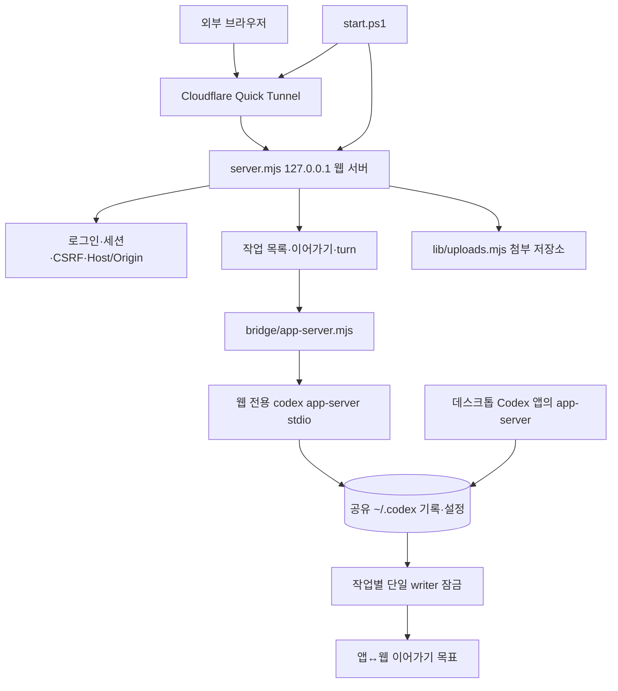

# Codex Remote Web 프로젝트 개요

이 문서는 지식그래프의 읽기 시작점입니다. **다음 작업에서 목적·설계 이유·관련 코드·검증·남은 일을 빠르게 찾는 것**이 목적입니다. 사실과 관계의 기준 원본은 `graph.sqlite3`이며, 이 문서는 핵심 탐색 안내입니다. 현재 revision은 관리 도구 `status`로 확인합니다.

## 현재 기준

- 저장 시작: 2026-09-24. 첫 Git 커밋 직전 작업 트리를 검토했습니다.
- Node 20+ ESM(검증은 Node v24.21.0), 외부 npm 의존성 없음. Windows 전용 스크립트(`start.ps1`, `stop.ps1`, `setup.mjs`의 ACL).
- 개인 PC에서 독립 `codex app-server`(stdio)를 띄워 `127.0.0.1` 웹 패널로 제어하고, Cloudflare Quick Tunnel로 외부 접속합니다.
- 운영 런타임 데이터(runtime config, 업로드 저장소, 로그)는 저장소 밖 `C:\Codex\Apps\CodexRemoteWeb\data\`에 있고, 비밀번호 해시·세션 키가 들어 있어 그래프에 값을 기록하지 않습니다.
- 사용자 목표는 **집 데스크톱 Codex 앱과 외부 웹에서 같은 작업 이어가기**(`goal.remote_continuity`)입니다.

## 큰 흐름

읽기용 요약이며 전체 관계·상태·근거는 SQLite와 revision별 자동 출력에서 확인합니다.

## 무엇부터 찾을까

| 다음 작업 | 시작 노드 | 연결되는 핵심 코드/테스트 |
|---|---|---|
| 집 작업이 웹 목록에 안 보임 | `issue.task_list_hidden`, `code.server.list_tasks` | [server.mjs](../server.mjs), [public/app.js](../public/app.js) |
| 앱과 웹에서 같은 작업을 이어가지 못함 | `issue.single_writer_lock`, `open.continuity_approach` | [server.mjs](../server.mjs) `resumeThread`, [bridge/app-server.mjs](../bridge/app-server.mjs) |
| 웹 서버가 Codex에 연결하지 못함 | `issue.codexexe_pinned`, `issue.no_reconnect` | [bridge/app-server.mjs](../bridge/app-server.mjs), [start.ps1](../start.ps1) |
| 로그인·보안 경계 | `policy.auth_boundary`, `policy.loopback_tunnel` | [server.mjs](../server.mjs), [test/remote.test.mjs](../test/remote.test.mjs) |
| 첨부 업로드 | `code.uploads` | [lib/uploads.mjs](../lib/uploads.mjs), [test/uploads.test.mjs](../test/uploads.test.mjs) |
| 전송 결과 불확실·중단 | `code.ui.dispatch`, `code.server.start_turn` | [public/dispatch-state.js](../public/dispatch-state.js), [test/turn-state.test.mjs](../test/turn-state.test.mjs), [test/dispatch-state.test.mjs](../test/dispatch-state.test.mjs) |
| 코드 리뷰 지적과 남은 결함 | `review.20260924` 및 연결된 `issue.*` | 해당 노드의 path |

예: `scripts/knowledge.py show issue.single_writer_lock`으로 관련 코드·미결·근거를 확인하고 필요한 파일만 읽습니다. 줄 번호는 보조 정보이며 앵커와 SHA256이 바뀌면 다시 확인합니다.

## 반드시 지킬 사실

- 웹 패널과 데스크톱 앱은 **서로 다른 app-server 프로세스**이고 같은 `~/.codex`를 공유합니다. 서로의 기록은 읽을 수 있지만, 한 작업을 쓰는 프로세스는 하나뿐입니다. 다른 프로세스의 `thread/resume`은 `already has an active writer`로 실패하고, 보유 프로세스가 종료될 때만 풀립니다(`thread/unsubscribe`로는 안 풀림, 2026-09-24 격리 시험).
- 웹 → 앱 인계는 `stop.ps1`, 앱 → 웹 인계는 데스크톱 앱 완전 종료가 필요합니다. 공식 원격 제어는 반대로 앱이 켜져 있어야 합니다. 방식 선택은 미결입니다.
- 웹 목록은 `C:\Codex\Projects`의 직접 하위 폴더 작업만, 그것도 첫 페이지만 보여 줍니다. 데스크톱 새 채팅(날짜 폴더)은 보이지 않습니다.
- 프로젝트 선택은 샌드박스가 아닙니다. 전역 `danger-full-access`를 상속해 웹에서도 PC 전체에 접근할 수 있습니다.
- 운영 설정의 `codexExe`는 데스크톱 앱 업데이트 때 사라지는 버전별 경로입니다. 2026-09-24에 현재 경로로 고쳤지만 다음 업데이트 때 다시 확인해야 합니다. 운영 포트는 LocalDeck과의 충돌 때문에 47841입니다.
- 저장소 테스트는 fake App Server를 씁니다. 실제 Codex·터널·데스크톱 앱과의 상호작용(잠금 포함)은 테스트 범위 밖입니다.

## 검증 상태와 남은 일

2026-09-24 첫 커밋 전 상태에서 `node --check` 8/8, `node --test` 50개 중 49 통과·1 skipped(파일 symlink 권한), 실패 0입니다(`validation.20260924_node`). 독립 코드 리뷰 결과는 `review.20260924`와 연결된 이슈 노드에 있습니다. 앱 종료 후 웹 인계는 사용자 보고로 동작을 확인했지만 메인이 화면을 직접 보지는 않았습니다.

남은 일: 이어가기 방식 결정(`open.continuity_approach`), 미승인 개선 후보(`open.web_improvements`), Codex 앱 안에서 띄운 웹 서버의 수명 가설 확인(`hypothesis.server_killed_with_app`).

## 실행과 정보 보존

설치·기동·종료는 [README](../README.md)를 따릅니다. 테스트는 `node --test test/*.test.mjs`, 문법 검사는 `package.json`의 `check` 스크립트입니다. 이 PC의 Node는 `C:\Codex\Apps\Development-SDKs-2026-09-20\node-lts\node.exe`입니다.

비밀번호·해시·세션 키·인증 토큰·계정 ID·터널 URL은 그래프에 기록하지 않습니다. 노드 상태는 verified(그 문장 범위 직접 확인), documented(문서·사용자 발언 근거), historical(과거 시점), hypothesis(미확정), untested(미검증·미결)로 구분합니다. 테스트 코드 존재는 해당 테스트가 오늘 통과했다는 뜻이 아닙니다.

다음 진입/갱신 절차는 [AI-READ-FIRST](../AI-READ-FIRST.md), 구축 검증은 [VALIDATION](VALIDATION.md)을 봅니다.
