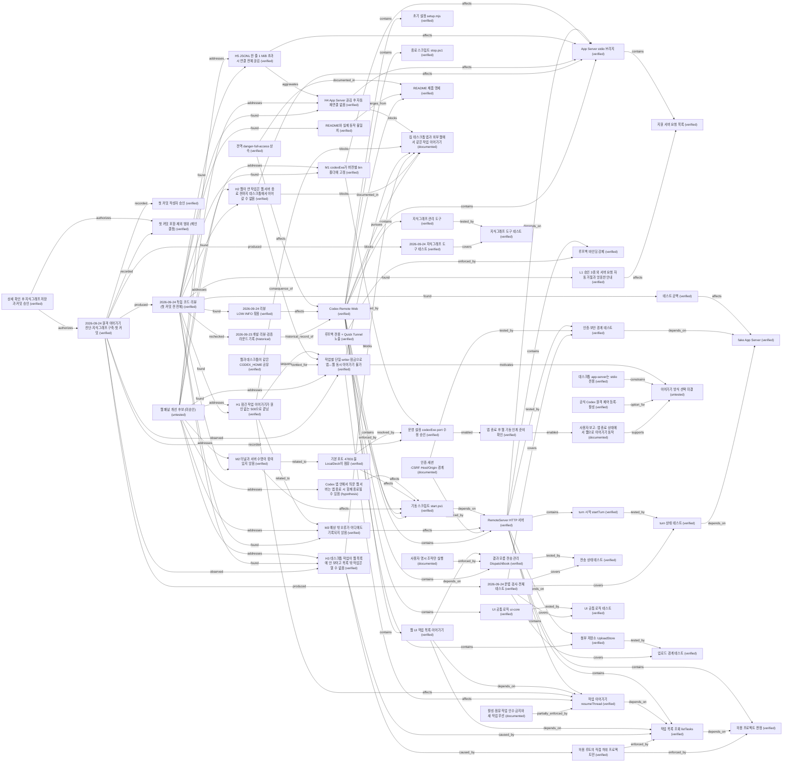

# Knowledge graph revision 1

### App Server stdio 브리지 (`code.bridge`)

Status: `verified`. Kind: `component`.

config.codexExe로 'codex app-server'(transport=proxy면 'app-server proxy')를 자식 프로세스로 띄우고 JSONL JSON-RPC를 중계한다. CODEX_HOME·USERPROFILE을 config로 지정한다. 연결이 끊기면 status 이벤트만 내고 재연결하지 않는다.

Source: [bridge/app-server.mjs:7](../../../bridge/app-server.mjs#L7)

Evidence:

- bridge/app-server.mjs 22-39행 connect
- bridge/app-server.mjs 137-153행 disconnect
- server.mjs에 reconnect 코드 없음 (grep 2026-09-24)

### 지원 서버 요청 목록 (`code.bridge.server_requests`)

Status: `verified`. Kind: `component`.

명령 승인·파일 변경 승인·사용자 입력 요청 4종 메서드만 UI로 넘기고, 그 밖의 App Server 요청은 -32601로 자동 거절한다.

Source: [bridge/app-server.mjs:112](../../../bridge/app-server.mjs#L112)

Evidence:

- bridge/app-server.mjs 110-126행

### 지식그래프 관리 도구 (`code.kg_tool`)

Status: `verified`. Kind: `component`.

WeatherAir 프로젝트의 scripts/knowledge.py를 2026-09-24 그대로 복사한 표준 라이브러리 전용 SQLite 지식그래프 도구(SHA256 FC5D6E50071AC8041DBF57DEDE0AAFB902EDE5E3239D335F80B71F12EF109923). init/status/check/search/show/apply(--expect-revision, --dry-run)/export를 제공하고 삭제 연산이 없다.

Source: [scripts/knowledge.py:335](../../../scripts/knowledge.py#L335)

Evidence:

- 원본 C:/Codex/Projects/WeatherAir/scripts/knowledge.py (WeatherAir에서도 미커밋 상태)
- scripts/knowledge.py 335행 apply_changes

### RemoteServer HTTP 서버 (`code.server`)

Status: `verified`. Kind: `component`.

로그인·세션·CSRF·Host/Origin 검사, 정적 파일, /api/* 라우팅, 작업 목록·읽기·시작·이어가기, turn 시작·중단·idempotency, 승인 중계, 업로드 API를 담당한다. 시작 시 App Server에 한 번 connect하고 실패하면 기동을 중단한다.

Source: [server.mjs:51](../../../server.mjs#L51)

Evidence:

- server.mjs 51-104행 (constructor, start)
- server.mjs 181-207행 api 라우팅

### 허용 프로젝트 판정 (`code.server.assert_allowed_project`)

Status: `verified`. Kind: `component`.

realpath 후 allowedRoots의 직접 하위 디렉터리일 때만 허용한다. Node realpath가 \\?\ 접두 경로를 일반 경로로 정규화하므로 Codex DB의 verbatim cwd도 통과한다.

Source: [server.mjs:443](../../../server.mjs#L443)

Evidence:

- server.mjs 443-453행
- 2026-09-24 Node v24.21.0 realpath('\\?\C:\Codex\Projects\CodexRemoteWeb') -> 'C:\Codex\Projects\CodexRemoteWeb' 실행 확인

### 작업 목록 조회 listTasks (`code.server.list_tasks`)

Status: `verified`. Kind: `component`.

thread/list를 인자 없이 한 번만 호출해 서버 기본 페이지(기본 정렬 created_at)만 받고, cwd가 allowedRoots의 직접 하위 폴더인 작업만 남긴다. 페이지네이션·정렬 지정·cwd 필터 인자를 쓰지 않는다.

Source: [server.mjs:463](../../../server.mjs#L463)

Evidence:

- server.mjs 462-471행
- codex app-server generate-json-schema ThreadListParams: limit 기본값 서버 결정, sortKey 기본 created_at (0.155.0-alpha.16.3)

### 루프백 바인딩 강제 (`code.server.loopback_guard`)

Status: `verified`. Kind: `component`.

bindHost가 127.0.0.1/localhost/::1이 아니면 생성자에서 예외를 던진다. 외부 노출은 Quick Tunnel 경유로만 생긴다.

Source: [server.mjs:58](../../../server.mjs#L58)

Evidence:

- server.mjs 58행

### 작업 이어가기 resumeThread (`code.server.resume_thread`)

Status: `verified`. Kind: `component`.

허용 목록에 있는 작업만 thread/resume한다. status가 active/running/in_progress/busy면 409로 막지만, 다른 프로세스가 writer lock을 쥔 idle 작업은 미리 판별하지 않고 App Server의 JSON-RPC 오류에 맡긴다. 성공 시 controlledThreads에 등록한다.

Source: [server.mjs:232](../../../server.mjs#L232)

Evidence:

- server.mjs 232-246행

### turn 시작 startTurn (`code.server.start_turn`)

Status: `verified`. Kind: `component`.

requestId 기반 idempotency, 첨부 ID 검증, controlledThreads에 없는 작업 거부(먼저 이어가기 필요), 모델/추론 수준 선택을 처리한다.

Source: [server.mjs:248](../../../server.mjs#L248)

Evidence:

- server.mjs 248-309행

### 초기 설정 setup.mjs (`code.setup`)

Status: `verified`. Kind: `component`.

무작위 접근 비밀번호의 scrypt 해시와 세션 키를 저장소 밖 data 폴더의 runtime-config.json에 쓰고 ACL을 잠근다. 비밀번호 원문은 별도 출력 파일에만 둔다.

Source: [setup.mjs:13](../../../setup.mjs#L13)

Evidence:

- setup.mjs 13행 secure
- README.md 8행

### 기동 스크립트 start.ps1 (`code.start_script`)

Status: `verified`. Kind: `component`.

cloudflared Quick Tunnel을 먼저 띄워 URL을 받고 publicOrigin을 config에 기록한 뒤 Node 서버를 시작하고 /health와 127.0.0.1 리스너 소유를 확인한다. owned-processes.json에 PID·시작 시각·경로를 남긴다.

Source: [start.ps1:36](../../../start.ps1#L36)

Evidence:

- start.ps1 36-63행

### 종료 스크립트 stop.ps1 (`code.stop_script`)

Status: `verified`. Kind: `component`.

owned-processes.json의 PID·시작 시각·경로가 모두 맞을 때만 서버와 터널을 종료한다. 기록 파일은 지우지 않는다.

Source: [stop.ps1:12](../../../stop.ps1#L12)

Evidence:

- stop.ps1 6-15행

### UI 공통 로직 ui-core (`code.ui.core`)

Status: `verified`. Kind: `component`.

첨부 안내문 분리(splitNotice), 붙여넣기 정책, 제목 추출 등 화면 공통 순수 함수.

Source: [public/ui-core.js:56](../../../public/ui-core.js#L56)

Evidence:

- public/ui-core.js 56행 splitNotice

### 결과 모름 전송 관리 DispatchBook (`code.ui.dispatch`)

Status: `verified`. Kind: `component`.

작업별 전송 기록을 고정해 결과 불확실(409/202/네트워크) 시 같은 본문으로만 재확인하고 9분 뒤 포기만 허용한다. 화면과 테스트가 같은 모듈을 쓴다.

Source: [public/dispatch-state.js:62](../../../public/dispatch-state.js#L62)

Evidence:

- public/dispatch-state.js 7-10행 상수, 62행 DispatchBook
- README.md 61-69행

### 웹 UI 작업 목록·이어가기 (`code.ui.tasks`)

Status: `verified`. Kind: `component`.

public/app.js가 /api/tasks를 받아 목록을 그리고, 기존 작업은 '이 작업 이어가기' 전까지 기록 보기 전용이며 이어가기에서 /api/tasks/resume을 호출한다.

Source: [public/app.js:408](../../../public/app.js#L408)

Evidence:

- public/app.js 279행 renderTasks, 408행 refreshTasks, 447행 tasks/resume 호출

### 첨부 저장소 UploadStore (`code.uploads`)

Status: `verified`. Kind: `component`.

소유 표식 폴더, 무작위 ID 파일명, 내용 서명 검사, 한도·보존·정리, manifest 원자적 교체를 구현한다. 세부 약속은 README '파일 첨부' 절.

Source: [lib/uploads.mjs:111](../../../lib/uploads.mjs#L111)

Evidence:

- lib/uploads.mjs 111행 이후
- README.md 36-115행

### 첫 커밋 작성자 승인 (`decision.commit_author_20260924`)

Status: `verified`. Kind: `decision`.

Git 사용자 설정이 없어 메인이 이 커밋에만 작성자 이름 glalm과 사용자 이메일을 지정하겠다고 제안했고, 사용자가 원문 '그 이름으로 진행'으로 승인했다(2026-09-24). 저장소·전역 git config는 바꾸지 않고 커밋 명령에만 지정한다.

Evidence:

- 세션 20260924 대화 사용자 원문

### 첫 커밋 포함·제외 범위 (메인 결정) (`decision.commit_scope_20260924`)

Status: `verified`. Kind: `decision`.

결정 주체: 메인, decision.kg_commit_20260924 승인 범위 안. 제외: work-artifacts/ui-fixture/(fixture 재생성 산출물, 21 MiB 거부용 샘플과 세션 해시·절대경로가 든 업로드 저장소 포함), *.tmp·*.tmp.md(잘못 만든 자리표시 파일), __pycache__/, knowledge/backups/. 포함: 소스·테스트·README·예시 설정, work-artifacts/review-input/(과거 리뷰 기록, 비밀 없음), work-artifacts/test-evidence/(지식그래프가 근거로 참조), 지식그래프 도구·DB·문서·export. .gitattributes에 '* -text'를 두어 mingit의 core.autocrlf=true에서도 바이트 그대로 저장해 지식그래프 SHA256 지문과 증거 해시를 보존. 제외 파일은 삭제하지 않고 .gitignore로만 뺐다.

Evidence:

- 독립 리뷰 커밋 위생 판단 (비밀 없음 확인)
- C:/Codex/Apps/Development-SDKs-2026-09-20/flutter/bin/mingit/mingw64/etc/gitconfig core.autocrlf=true
- 작업 트리 파일 줄바꿈 전부 LF (2026-09-24 확인)

### 운영 설정 codexExe·port 수정 승인 (`decision.config_update_20260924`)

Status: `verified`. Kind: `decision`.

사용자 원문 '설정 수정해도 돼' (2026-09-24). 메인이 C:\Codex\Apps\CodexRemoteWeb\data\runtime-config.json을 runtime-config.json.bak-20260924-133545로 백업한 뒤 codexExe를 bin\80f78947ad880e6e\codex.exe로, port를 47831에서 47841로 바꿨다. 선행 지시 원문: '데스크톱 앱은 껐어. 웹 다시 띄워봐 한번 시도해볼게.'

Evidence:

- 세션 20260924 대화 사용자 원문 2건
- 백업 파일 C:/Codex/Apps/CodexRemoteWeb/data/runtime-config.json.bak-20260924-133545

### 상세 확인 후 지식그래프 저장과 커밋 승인 (`decision.kg_commit_20260924`)

Status: `verified`. Kind: `decision`.

사용자 원문 '일단 이 프로젝트를 아주 상세하게 확인한 후 지식그래프 저장하고 커밋 진행.' (2026-09-24). 이 지시로 지식그래프 구축·기록 범위와 첫 Git 커밋이 승인되었다. 제품 코드 수정은 포함되지 않는다.

Evidence:

- 세션 20260924 대화 사용자 원문

### README 제품 명세 (`doc.readme`)

Status: `verified`. Kind: `document`.

동작·보안 약속의 기준 문서. 준비·보안 경계·App Server 제한·알려진 권한 문제·화면·파일 첨부·로컬 UI fixture·검사 절을 가진다. 'App Server 제한' 절은 활성 또는 다른 writer가 점유한 작업을 resume하지 않는다고 적는다.

Source: [README.md:19](../../../README.md#L19)

Evidence:

- README.md 전체 1-145행 (2026-09-24 읽음)

### 집 데스크톱 앱과 외부 웹에서 같은 작업 이어가기 (`goal.remote_continuity`)

Status: `documented`. Kind: `goal`.

사용자 실사용 목표. 2026-09-24 사용자 원문: '코덱스 리모트 웹 관련해서 세션이 달라서 그런지 온라인에서는 집에서 한 작업 확인도 안되고 웹에서 한 작업은 집에서 확인은 되지만 작업을 이어서 하는것도 안되는 것 같은데 어떻게 해야해?' 이 문제 제기에서 도출한 목표이며, 해결 방식(공식 원격 제어 vs 웹 패널 인계)은 아직 사용자가 정하지 않았다.

Evidence:

- 세션 20260924 대화 첫 사용자 요청 원문

### Codex 앱 안에서 띄운 웹 서버는 앱 종료 시 함께 종료될 수 있음 (`hypothesis.server_killed_with_app`)

Status: `hypothesis`. Kind: `hypothesis`.

Codex 앱이 실행한 프로세스는 Windows Job에 속한다(IsProcessInJob=true 관측). 2026-09-24 03:55에 띄운 웹 서버·터널이 오류 로그·Windows 충돌 이벤트 없이 사라졌고 그 사이 09:53에 앱이 업데이트 재시작했다. 인과는 미확정. 확인 방법: Codex 앱 안에서 start.ps1 실행 → 앱 종료 → 서버 생존 확인. 종결 조건: 그 시험 결과.

Evidence:

- C:/Codex/Apps/CodexRemoteWeb/data/logs server-ui-upload-deploy-20260923T185538Z-0c3368-new.stderr.log 0바이트
- Get-WinEvent Application 1000/1002/1026 node·cloudflared 항목 없음 (2026-09-23 이후)
- ChatGPT.exe 시작 2026-09-24 09:53:00

### M1 codexExe가 버전별 bin 폴더에 고정 (`issue.codexexe_pinned`)

Status: `verified`. Kind: `issue`.

MEDIUM. 예시 config와 .env.example이 %LOCALAPPDATA%\OpenAI\Codex\bin\<hash>\codex.exe 같은 버전 경로를 권장하고, start.ps1은 cloudflared만 검증한다. 앱 업데이트로 옛 폴더가 지워지면 spawn ENOENT로 서버가 시작하지 못하고 start.ps1은 'Node server stopped during startup.'만 출력한다(원인은 data\logs\server-*.stderr.log에만 있음). 2026-09-24 09:53 업데이트로 운영 설정의 bin\247581e40ee272fb가 실제로 삭제된 상태였다. 빈 값이면 PATH의 codex를 쓰지만 npm 설치 codex.cmd는 셸 없이 실행되지 않는다. 권장: 터널 기동 전 codexExe 존재 검증, 실패 시 stderr 끝부분 출력, 최신 버전 폴더 자동 선택, 예시·README 수정.

Source: [config.example.json:7](../../../config.example.json#L7)

Evidence:

- config.example.json 7행, .env.example 3행, setup.mjs 27행, start.ps1 15-16행, README.md 9행
- C:/Users/glalm/AppData/Local/OpenAI/Codex/bin 목록 (2026-09-24)
- server.mjs 100-101행

### M3 예상 밖 오류가 어디에도 기록되지 않음 (`issue.errors_unlogged`)

Status: `verified`. Kind: `issue`.

MEDIUM. status 없는 오류는 500 'Internal server error'로만 응답하고 stderr·이벤트에 남지 않는다. writer lock 거절, 연결 끊김, thread/list 실패를 진단할 수 없다. 권장: 경로·메서드·rpc code·정제된 메시지를 stderr에 기록.

Source: [server.mjs:118](../../../server.mjs#L118)

Evidence:

- server.mjs 83행, 116-120행

### 전역 danger-full-access 상속 (`issue.full_access`)

Status: `verified`. Kind: `issue`.

웹 패널의 app-server는 사용자 전역 Codex 설정을 상속한다. 2026-09-24 전역 config.toml의 sandbox_mode는 danger-full-access였다. 웹에서도 선택 프로젝트 밖을 포함한 PC 전체 파일 읽기·쓰기·명령 실행이 가능하며 패널은 이를 막지 않는다.

Evidence:

- README.md 23-25행 알려진 권한 문제
- C:/Users/glalm/.codex/config.toml 5행 sandbox_mode (2026-09-24 grep, 값 외 내용은 기록하지 않음)

### H5 JSONL 한 줄 1 MiB 초과 시 연결 전체 끊김 (`issue.jsonl_line_limit`)

Status: `verified`. Kind: `issue`.

HIGH(코드 경로 확인, 실제 발생 빈도는 미측정). 브리지는 버퍼가 1024*1024문자를 넘으면 연결을 끊는다. 긴 작업의 thread/read 응답이나 미리보기를 자르지 않는 thread/list 응답(숨길 작업까지 포함)이 이를 넘으면 로그인 직후 목록 로딩에서 끊기고, H4 때문에 재시작마다 반복될 수 있다. 권장: 상한 확대 또는 초과 메시지만 버리고 해당 요청만 실패, limit·cwd 필터로 응답 축소, 브라우저에 최소 필드만 전달, 운영 응답 크기 측정.

Source: [bridge/app-server.mjs:5](../../../bridge/app-server.mjs#L5)

Evidence:

- bridge/app-server.mjs 5행, 85-87행
- server.mjs 229행, 463행
- reviewer probe 110만 자 줄 → 'App Server JSONL line is too large', 연결 [true,false]

### H4 App Server 끊김 후 자동 재연결 없음 (`issue.no_reconnect`)

Status: `verified`. Kind: `issue`.

HIGH. connect는 서버 기동 시 한 번뿐이고 끊기면 재시도하지 않으며 buffer·decoder도 초기화하지 않는다. 끊기는 순간 controlledThreads·activeTurns·승인이 모두 지워지고 이후 모든 요청이 'App Server is unavailable'로 500이 된다. 화면은 'Codex 오프라인'만 보여 준다. 원격에서는 복구할 수 없고 PC에서 재시작해야 하며 새 URL은 로컬 파일에만 기록된다. 권장: 백오프 재연결(decoder·buffer 초기화), 끊긴 이유 UI 표시, README 문서화.

Source: [bridge/app-server.mjs:22](../../../bridge/app-server.mjs#L22)

Evidence:

- bridge/app-server.mjs 22-39행, 137-153행
- server.mjs 78행, 100행 (유일한 connect 호출)
- reviewer probe: nextRequest 'App Server is unavailable', spawns 1

### 기본 포트 47831을 LocalDeck이 점유 (`issue.port_conflict`)

Status: `verified`. Kind: `issue`.

2026-09-24 LocalDeck.PC.exe가 0.0.0.0:47831에서 대기 중이었다. start.ps1은 터널을 서버보다 먼저 띄우므로 같은 포트에서는 서버 기동 전 터널이 다른 프로그램에 연결될 여지가 있다. 운영 설정 포트를 47841로 옮겨 해소했다.

Evidence:

- Get-NetTCPConnection -LocalPort 47831 (2026-09-24, OwningProcess LocalDeck.PC.exe)
- start.ps1 36행 터널 선기동

### README와 실제 동작 불일치 (`issue.readme_mismatch`)

Status: `verified`. Kind: `issue`.

README 21행은 다른 writer 점유 작업을 resume하지 않는다고 하지만 사전 탐지 없이 일반 500으로 끝난다(H1). 웹이 연 작업 잠금 유지·재연결 없음·재시작 시 URL 변경·인계 절차가 기재되지 않았다(H2·H4). 17·29행의 최근 작업은 실제로 첫 페이지·생성순·직접 하위만(H3). 9행 codexExe 예시가 버전 경로(M1). 10행 명명된 도메인 publicOrigin 지정은 start.ps1 46행이 매번 Quick Tunnel URL로 덮어쓴다. .env.example 변수는 코드가 읽지 않는다. 8행 세션 키는 사용되지 않고 세션은 메모리 전용이라 재시작 시 전원 로그아웃. 7행 Node 20 이상이지만 --test 인자 glob은 Node 21+ 기능(Windows Node 20에서 실패 가능, 미확인). 운영 중 127.0.0.1 직접 접속은 /health 외 421.

Source: [README.md:21](../../../README.md#L21)

Evidence:

- 독립 리뷰 README 불일치 표
- README.md 7-21행, start.ps1 46행, setup.mjs 29행

### H1 잠긴 작업 이어가기가 원인 없는 500으로 끝남 (`issue.resume_error_opaque`)

Status: `verified`. Kind: `issue`.

HIGH. 데스크톱이 연 작업은 웹 app-server의 thread/list에서 notLoaded/idle로 보여 사전 차단을 통과하고, thread/resume의 -32600 'already has an active writer' rpcError에는 status가 없어 fail()이 500 'Internal server error'로 바꾼다. 사용자는 '서버 오류가 발생했습니다' 토스트만 반복해 보고 원인은 어디에도 기록되지 않는다. 목록의 실행 중 표시와 '다른 곳에서 실행 중' 안내도 다른 프로세스 상태를 반영하지 못한다. 권장: resume rpcError를 409와 구체 안내로 변환, 예상 밖 오류 stderr 기록, README 21행 수정.

Source: [server.mjs:116](../../../server.mjs#L116)

Evidence:

- server.mjs 232-246행, 83행, 116-120행
- public/app.js 30행, 435행, 441-455행
- reviewer probe RESUME status 500

### 2026-09-24 리뷰 LOW·INFO 묶음 (`issue.review_low_20260924`)

Status: `verified`. Kind: `issue`.

LOW 지적 묶음. L2 터널 뒤에서는 remoteAddress가 항상 127.0.0.1이라 로그인 백오프가 전역 한 버킷(가용성 문제). L3 승인 카드에 작업 표시 없음, diff만 온 파일 변경은 diff 미표시. L4 stderr 정제가 비캡처 그룹에 '$1'을 써 '$1=[redacted]'가 그대로 들어가고 Bearer·API_KEY는 정제하지 않으며 이 문자열이 /api/state로 나간다(인증 사용자만). L5 확실한 미전송('App Server is unavailable')도 409 uncertain으로 분류되어 첨부가 attempted로 14일 보존. L6 전송용 첨부 선점(claim)이 영속되지 않아 전송 중 서버가 죽으면 재시작 정리가 참조됐을 수 있는 파일을 지울 수 있음. L7 itemContexts 무한 증가. L8 미사용 설정·코드(.env.example 변수, setup의 sessionKey, allowedProjects, declared 목록). L9 /api/tasks가 thread 원본(잘리지 않은 미리보기·로컬 경로)을 그대로 전달. L10 테스트가 실행마다 work-artifacts/test-evidence에 파일 생성. L11 start.ps1 URL 정규식이 cloudflared 오류 줄의 api.trycloudflare.com을 오인할 수 있고 공개 URL 도달 확인이 없음. INFO: 본문 JSON null·잘못된 % 인코딩 ID에 500, resume 시 controlledThreads가 프로젝트 기록보다 먼저 추가, 날짜 채팅 폴더 경로 하드코딩(setup.mjs 10행, start.ps1 10행), Start-Process 인자 미인용으로 공백 경로 실패, HSTS 없음, stop.ps1이 모든 예외를 already absent로 표시.

Evidence:

- 독립 리뷰 L2-L11·INFO 항목의 파일:줄 (server.mjs 158-171행, bridge/app-server.mjs 155-159행, server.mjs 293-303행, lib/uploads.mjs 334-337행, server.mjs 75행·476-478행, start.ps1 41-42행 등)
- reviewer sanitizer-check 출력 'error: $1=[redacted] $1=[redacted] Authorization: Bearer ...'

### 작업별 단일 writer 잠금으로 앱↔웹 동시 이어가기 불가 (`issue.single_writer_lock`)

Status: `verified`. Kind: `issue`.

Codex는 작업마다 프로세스 단위 writer lock(~/.codex/thread-writer-locks/<id>.lock)을 둔다. 다른 프로세스는 thread/read는 되지만 thread/resume은 '-32600 thread <id> already has an active writer'로 실패한다. 작업이 idle이어도, 보유 측이 thread/unsubscribe를 해도 60초 동안 풀리지 않았고, 보유 프로세스가 종료되자 즉시 이어받기와 새 turn이 성공했다. 데스크톱 앱은 몇 시간 쉰 작업도 잠금을 유지했다.

Evidence:

- 격리 시험 C:/Users/glalm/AppData/Local/Temp/claude/C--Codex-Projects-CodexRemoteWeb/dd6a1cfd-f4be-4ad5-b61e-1c1e782d6851/scratchpad/locktest.mjs (임시 CODEX_HOME, codex 0.155.0-alpha.16.3, 2026-09-24)
- 2026-09-24 데스크톱 앱 실행 중 잠금 7개 보유 관측, 앱 종료 후 10개 모두 해제 관측

### H3 데스크톱 작업이 웹 목록에 안 보이고 목록 밖 작업은 열 수 없음 (`issue.task_list_hidden`)

Status: `verified`. Kind: `issue`.

HIGH. (a) 데스크톱 새 채팅은 C:\Codex\YYYY-MM-DD\new-chat 같은 폴더라 허용 루트 필터에 모두 숨겨진다. (b) thread/list {}로 첫 페이지만 created_at 순으로 받아, 허용 프로젝트 작업도 페이지 밖이면 안 보이고 ID로 열거나 이어가도 403 'Thread is not in an allowed project'가 난다(readThread·resumeThread가 목록 소속에 의존). (c) 프로젝트 하위 폴더를 cwd로 쓰는 작업도 숨겨진다. 2026-09-24 state DB 읽기 전용 조회: 보관 안 된 사용자 작업 51개 중 C:\Codex\Projects 아래 8개. 권장: limit·sortKey updated_at/recency_at·nextCursor 상한 추적·cwd 필터, 열기/이어가기는 작업 cwd 직접 확인. 날짜 폴더 허용 여부는 범위 결정 필요.

Source: [server.mjs:463](../../../server.mjs#L463)

Evidence:

- server.mjs 225-230행, 235-237행, 443-453행, 462-471행
- C:/Users/glalm/.codex/state_5.sqlite threads 읽기 전용 조회 (2026-09-24)
- 독립 리뷰 H3 CONFIRMED

### 테스트 공백 (`issue.test_gaps`)

Status: `verified`. Kind: `issue`.

테스트가 없는 경로: 연결 끊김·재연결·1 MiB 줄 제한, resume rpcError 응답 변환, thread/list 페이지 넘김·정렬·하위 폴더 cwd·목록 밖 작업 열기/이어가기(fake는 1페이지만), 지원 외 요청 자동 거절 안내, 프로젝트 밖 cwd 승인 차단·diff 표시, 로그인 백오프·동시 요청 제한, 세션 절대 만료. start.ps1·stop.ps1·setup.mjs는 자동 검증 없음. app.js 화면 동작은 소스 정규식 검사로만 확인. turn-state 테스트에 300ms 타이밍 의존이 남음. fake App Server는 실제 Codex의 다중 프로세스 writer lock을 흉내 내지 않는다.

Evidence:

- 독립 리뷰 테스트 공백 절
- test/fake-codex.mjs
- test/turn-state.test.mjs 57-62행

### M2 터널과 서버 수명이 묶여 있지 않음 (`issue.tunnel_server_lifecycle`)

Status: `verified`. Kind: `issue`.

MEDIUM(기동 순서는 확인, 노출은 가능성). start.ps1은 포트 사전 확인 없이 터널을 서버보다 먼저 띄우고 기동 후 감시도 없다. (a) 서버 listen 전 몇 초간 같은 포트의 다른 프로그램으로 공개 URL이 연결될 수 있다(2026-09-24 LocalDeck이 47831 점유 관측). (b) 운영 중 node가 죽어도 cloudflared가 남아 알려진 URL이 이후 그 포트를 잡는 프로그램으로 연결될 수 있다. node가 죽을 수 있는 경로: child.stdin에 error 리스너가 없어 EPIPE가 uncaught, 끊긴 뒤 도착한 데이터 처리 중 #write 예외, 프로세스 수준 예외 처리기 없음. 권장: 모든 주소 대상 포트 점유 검사 후 중단, 서버 사망 시 터널 동반 종료, stdin error 처리.

Source: [start.ps1:36](../../../start.ps1#L36)

Evidence:

- start.ps1 36행(터널), 51행(서버)
- bridge/app-server.mjs 30-34행, 80-83행, 110-122행
- server.mjs 557-567행
- Get-NetTCPConnection 47831 (2026-09-24)

### L1 승인 3종 외 서버 요청 자동 거절과 엉뚱한 안내 (`issue.unsupported_requests`)

Status: `verified`. Kind: `issue`.

LOW. 명령 승인·파일 변경 승인·사용자 입력 외 요청(예: mcpServer/elicitation/request, item/permissions/requestApproval)은 즉시 -32601로 거절되어 해당 기능이 조용히 실패할 수 있다. unsupported 이벤트에 threadId·method가 없어 '승인 요청이 차단되었습니다'가 지금 열린 아무 작업에나 표시된다. 앱 전용 도구(computer use, codex_app 번들 플러그인, code_mode_host)도 웹 app-server에서는 켜지지 않는다(2026-09-24 프로세스 관측).

Source: [bridge/app-server.mjs:112](../../../bridge/app-server.mjs#L112)

Evidence:

- bridge/app-server.mjs 110-122행
- server.mjs 80행, 498-501행, 507-510행
- public/app.js 842-846행
- 2026-09-24 데스크톱 app-server 명령줄, codex-computer-use-swift.exe 부모 ChatGPT.exe

### H2 웹이 연 작업은 웹 서버 종료 전까지 데스크톱에서 이어갈 수 없음 (`issue.web_lock_until_stop`)

Status: `verified`. Kind: `issue`.

HIGH. 웹 app-server 자식 프로세스는 서버 수명 동안 하나뿐이고 종료 외 잠금 해제 경로가 없다. 데스크톱으로 넘기려면 stop.ps1로 터널까지 내려야 하고 다시 start.ps1을 하면 URL이 바뀐다. README에 인계 절차가 없다. 권장: README 인계 절차 문서화, codex 자식만 재시작하는 '데스크톱으로 넘기기' 동작 검토. transport=proxy 공유안은 데스크톱 app-server가 stdio 전용이라 현재 불가(obs.desktop_stdio_only).

Source: [bridge/app-server.mjs:75](../../../bridge/app-server.mjs#L75)

Evidence:

- server.mjs 216-223행, 232-246행
- bridge/app-server.mjs 22-39행, 75-78행
- stop.ps1 6-15행
- issue.single_writer_lock 격리 시험

### 데스크톱 app-server는 stdio 전용 (`obs.desktop_stdio_only`)

Status: `verified`. Kind: `observation`.

데스크톱 앱(ChatGPT.exe)이 띄운 codex app-server는 --listen 없이 stdio로만 동작하고 control socket이 없다. 따라서 웹의 transport=proxy로 데스크톱 app-server에 붙을 수 없다.

Evidence:

- 2026-09-24 PID 17120 명령줄
- codex app-server proxy --help (control socket 연결 방식)
- ~/.codex 아래 socket 파일 없음

### 앱 종료 후 웹 기동 인계 준비 확인 (`obs.handover_prereq_20260924`)

Status: `verified`. Kind: `observation`.

2026-09-24 사용자가 데스크톱 앱을 종료한 뒤 codex·ChatGPT 프로세스가 없고 writer lock 10개가 모두 해제됨을 확인했다. 설정 변경 후 start.ps1로 서버(127.0.0.1:47841)·터널·웹 app-server가 기동했고 로컬과 외부 /health가 200 {ok:true}였다. 서버 stderr는 비어 있었다.

Evidence:

- C:/Codex/Apps/CodexRemoteWeb/data/logs server-20260924-133555.stderr.log 0바이트
- cloudflared stderr 'Registered tunnel connection' 2026-09-24T04:35:59Z

### 공식 Codex 원격 제어 등록·활성 (`obs.remote_control_enrolled`)

Status: `verified`. Kind: `observation`.

이 PC(서버 이름 Luminous)의 Codex Desktop이 공식 원격 제어에 등록되어 있고 remote_control_enabled=1, config.toml에 keepRemoteControlAwakeWhilePluggedIn=true. 원격 제어는 데스크톱 app-server 안에서 동작하므로 앱이 켜져 있어야 한다(로그 target 기준 추론). 외부 접속 화면 절차는 확인하지 않았다.

Evidence:

- ~/.codex/state_5.sqlite remote_control_enrollments 비밀 아닌 열만 읽기 전용 조회 (2026-09-24)
- ~/.codex/logs_2.sqlite target codex_app_server_transport::transport::remote_control::websocket

### 웹과 데스크톱이 같은 CODEX_HOME 공유 (`obs.shared_codex_home`)

Status: `verified`. Kind: `observation`.

운영 runtime config의 codexHome은 C:\Users\glalm\.codex로 데스크톱 앱과 같다. 기록(rollout·state DB)과 설정을 공유하므로 서로의 작업을 읽을 수는 있다. transport는 stdio다.

Evidence:

- C:/Codex/Apps/CodexRemoteWeb/data/runtime-config.json 비밀 아닌 필드만 조회 (2026-09-24)

### 사용자 보고: 앱 종료 상태에서 웹으로 이어가기 동작 (`obs.user_handover_success_20260924`)

Status: `documented`. Kind: `observation`.

사용자 원문 '되네? 그럼 앱이 꺼져있으니 내 로컬 파일 접근은 불가하지만 work 사용하듯이 이용이 가능한건가?' 사용자가 웹에서 시도해 동작을 확인했다. 어떤 작업을 이어갔는지와 화면 결과는 메인이 직접 보지 않았다.

Evidence:

- 세션 20260924 대화 사용자 보고 원문

### 이어가기 방식 선택 미결 (`open.continuity_approach`)

Status: `untested`. Kind: `open`.

미결(사용자 결정 대기). 선택지: (1) 공식 원격 제어 — 앱을 켜 둔 채 데스크톱 app-server를 직접 조종, 인계 절차 없음. (2) 웹 패널 — 한 번에 한 프로세스만 쓰기, 앱→웹은 앱 완전 종료, 웹→앱은 stop.ps1 후 앱 실행. 두 방식은 앱 실행 조건이 반대라 섞어 쓸 수 없다. 종결 조건: 사용자의 방식 결정.

Evidence:

- issue.single_writer_lock
- obs.remote_control_enrolled

### 웹 패널 개선 후보 (미승인) (`open.web_improvements`)

Status: `untested`. Kind: `open`.

메인이 제안했으나 승인되지 않은 개선: 작업 목록 페이지네이션·updated_at 정렬·실사용 경로 반영, 잠긴 작업 '다른 곳에서 사용 중' 표시와 이어가기 차단, 최신 codex.exe 자동 탐색, Codex 앱 밖 독립 기동 절차. thread/unsubscribe로 잠금을 푸는 방안은 시험으로 기각되었다. 데스크톱이 연 작업을 웹이 이어받는 것은 코드로 해결할 수 없다.

Evidence:

- 세션 20260924 대화 제안
- issue.single_writer_lock 시험 결과

### 허용 루트의 직접 하위 프로젝트만 (`policy.allowed_projects`)

Status: `verified`. Kind: `policy`.

작업 시작·목록·이어가기는 allowedRoots(현재 C:\Codex\Projects)의 실제 존재하는 직접 하위 폴더만 대상으로 한다. 이것은 작업 폴더 선택이지 샌드박스가 아니다.

Evidence:

- README.md 17행, 25행
- server.mjs 443-453행, 462-471행

### 인증·세션·CSRF·Host/Origin 경계 (`policy.auth_boundary`)

Status: `documented`. Kind: `policy`.

모든 API는 로그인 후 HttpOnly/SameSite=Strict 세션, 정확한 Host/Origin, CSRF 토큰을 확인한다. 임의 터미널·파일 브라우저·RPC는 제공하지 않는다.

Evidence:

- README.md 17행
- server.mjs 122-156행
- test/remote.test.mjs

### 사용자 명시 조작만 실행 (`policy.explicit_actions`)

Status: `documented`. Kind: `policy`.

초기 구성과 기동은 Codex 작업을 자동 실행하지 않는다. 새 작업·전송·중단·승인은 패널에서 명시적으로 수행한다. 결과 모름 전송은 자동 재전송하지 않는다.

Evidence:

- README.md 13행, 57행, 65행

### 루프백 전용 + Quick Tunnel 노출 (`policy.loopback_tunnel`)

Status: `verified`. Kind: `policy`.

서버는 루프백에만 바인딩하고 외부 HTTPS 주소는 Quick Tunnel이 만든다. 터널 앞단 인증은 제공하지 않으며 URL은 매 시작마다 바뀐다.

Evidence:

- README.md 3행, 10행, 17행
- server.mjs 58행

### 활성·점유 작업 인수 금지와 새 작업 우선 (`policy.no_active_takeover`)

Status: `documented`. Kind: `policy`.

README는 활성 상태이거나 다른 writer가 점유한 기존 작업을 resume하지 않으며 새 웹 작업이 신뢰할 수 있는 기본 흐름이라고 약속한다. 코드는 status 기반 활성 판정만 하고 writer 점유는 App Server 오류로 드러난다.

Evidence:

- README.md 21행
- server.mjs 238-241행

### Codex Remote Web (`project.codexremoteweb`)

Status: `verified`. Kind: `project`.

개인 Windows PC에서 독립 codex app-server(stdio)를 띄워 127.0.0.1 웹 패널로 제어하고, Cloudflare Quick Tunnel로 외부에서 접속하는 실험용 도구. Node 20+ ESM, 외부 npm 의존성 없음. 2026-09-24 첫 커밋 전 작업 트리 기준으로 소스·README·테스트를 확인했다.

Source: [README.md:1](../../../README.md#L1)

Evidence:

- README.md 1-21행
- package.json (type=module, 의존성 없음)
- server.mjs, bridge/app-server.mjs, lib/uploads.mjs, public/*

### 2026-09-24 독립 코드 리뷰 (첫 커밋 전 전체) (`review.20260924`)

Status: `verified`. Kind: `review`.

구현과 분리된 reviewer가 첫 커밋 전 작업 트리 전체(25개 파일, 검토 전후 SHA256 변화 0, work-artifacts/review-input/candidate-delivery-hashes.json 24개 항목과 일치)를 검토했다. critical 보안 결함 없음. 인증·세션·CSRF·Host/Origin·업로드 저장 경계·경로 이탈 방어는 견고하다고 판단. 사용자 목표(앱↔웹 이어가기)를 막는 HIGH 5건(H1-H5), MEDIUM 3건(M1-M3), LOW 11건(L1-L11)과 INFO를 보고했다. 이전 라운드 지적: 조기 중단·R1-R7·F1 해결, F2 코드상 해결·테스트 없음, F3 코드상 해결·실기기 미검증, 300ms 테스트 창·안내 줄 0개 허용·declared 목록 미사용·tmp 파일은 미해결. 메인이 H1(fail의 500 변환), H5(MAX_LINE), L4(치환 버그)를 원본에서 재확인했다.

Evidence:

- reviewer 반환 보고 (세션 20260924, 원문은 대화 기록)
- reviewer probe: BRIDGE firstListResult 'App Server JSONL line is too large', statuses [true,false]; RESUME status 500 'Internal server error'
- server.mjs 116-120행, bridge/app-server.mjs 5행·156행 메인 재확인

### 2026-09-24 원격 이어가기 진단·지식그래프 구축·첫 커밋 (`session.20260924-knowledge-bootstrap`)

Status: `verified`. Kind: `session`.

요청: 앱↔웹 작업 이어가기 문제 진단, 운영 설정 수정·재기동, 상세 확인 후 지식그래프 저장과 커밋. 수행: 원인 진단(목록 필터·단일 writer 잠금), 격리 잠금 시험, 운영 설정 백업·수정과 웹 재기동, 문법 검사·전체 테스트(runner), 독립 전체 리뷰(reviewer), 지식그래프 도구 복사·시험·구축. 제품 코드는 수정하지 않았고 리뷰 지적(H1-H5 등)은 미수정 상태다. 첫 Git 커밋은 이 revision 적용 후 수행하며 해시는 git log로 확인한다. 미수행: 실제 브라우저 UI 확인, 공식 원격 제어 접속 확인, Codex 앱 안에서 띄운 서버의 수명 시험.

Evidence:

- 세션 20260924 대화
- C:/Codex/Scratch/CodexRemoteWebKnowledge/ 작업 입력·로그
- work-artifacts/test-evidence/initial-commit-validation-raw-20260924.txt

### 전송 상태 테스트 (`test.dispatch_state`)

Status: `verified`. Kind: `test`.

DispatchBook·응답 분류·초안 보존·트레이 재동기화를 검사한다.

Source: [test/dispatch-state.test.mjs](../../../test/dispatch-state.test.mjs)

Evidence:

- test/dispatch-state.test.mjs

### fake App Server (`test.fake_codex`)

Status: `verified`. Kind: `test`.

실제 계정·모델·네트워크 없이 App Server 프로토콜을 흉내 내는 테스트·fixture용 가짜 서버. 실제 Codex의 writer lock이나 다중 프로세스 동작은 흉내 내지 않는다.

Source: [test/fake-codex.mjs:21](../../../test/fake-codex.mjs#L21)

Evidence:

- test/fake-codex.mjs 21행 FakeCodex

### 지식그래프 도구 테스트 (`test.kg_tool`)

Status: `verified`. Kind: `test`.

WeatherAir에서 그대로 복사한 도구 테스트(SHA256 6AA6B94964F617A932AEE1E1412FBBF3DB469C84371B995E7EC57BCF9B29D379). 임시 합성 DB만 사용한다.

Source: [scripts/tests/test_knowledge.py](../../../scripts/tests/test_knowledge.py)

Evidence:

- scripts/tests/test_knowledge.py

### 인증·보안 경계 테스트 (`test.remote`)

Status: `verified`. Kind: `test`.

fake App Server로 인증, CSRF, 경로 이탈, 세션 로그아웃, idempotency, 승인 왕복을 검사한다.

Source: [test/remote.test.mjs](../../../test/remote.test.mjs)

Evidence:

- test/remote.test.mjs
- README.md 142행

### turn 상태 테스트 (`test.turn_state`)

Status: `verified`. Kind: `test`.

응답 직후 중단, 응답보다 먼저 끝난 turn, 202 확인 흐름, 합쳐진 기록 표시를 검사한다.

Source: [test/turn-state.test.mjs](../../../test/turn-state.test.mjs)

Evidence:

- test/turn-state.test.mjs

### UI 공통 로직 테스트 (`test.ui_core`)

Status: `verified`. Kind: `test`.

splitNotice, 붙여넣기 정책 등 ui-core 순수 함수를 검사한다.

Source: [test/ui-core.test.mjs](../../../test/ui-core.test.mjs)

Evidence:

- test/ui-core.test.mjs

### 업로드 경계 테스트 (`test.uploads`)

Status: `verified`. Kind: `test`.

업로드 인증·한도·내용 서명·경로 이탈·junction·소유 표식·보존·인덱스 복구 등을 검사한다. 파일 symlink 선행 배치 테스트는 권한이 없으면 skipped로 보고한다.

Source: [test/uploads.test.mjs](../../../test/uploads.test.mjs)

Evidence:

- test/uploads.test.mjs
- README.md 142-144행

### 2026-09-23 개발 리뷰·검증 라운드 기록 (`validation.20260923_rounds`)

Status: `historical`. Kind: `validation`.

첨부·전송 상태 기능 개발 중 리뷰 1·2차와 최종 리뷰, 라운드별 검증 로그와 후보 해시가 work-artifacts에 남아 있다. 과거 시점 기록이며 현재 통과를 뜻하지 않는다.

Evidence:

- work-artifacts/review-input/review-round1.md, review-round2.md, review-final-findings.md
- work-artifacts/test-evidence/round1-validation-raw.txt, round2-validation-raw.txt, dispatch-fix-validation-raw.txt

### 2026-09-24 지식그래프 도구 테스트 (`validation.20260924_kg_tool`)

Status: `verified`. Kind: `validation`.

python -X utf8 -m unittest -v scripts.tests.test_knowledge: 13개 중 12 통과·1 skipped(디렉터리 symlink 권한 없음), 종료 0. Python 3.12.14 번들 런타임. 임시 합성 DB만 사용.

Evidence:

- C:/Codex/Scratch/CodexRemoteWebKnowledge/tooltest-20260924-1.log

### 2026-09-24 문법 검사·전체 테스트 (`validation.20260924_node`)

Status: `verified`. Kind: `validation`.

첫 커밋 전 작업 트리에서 node --check 8개 모두 종료 0, node --test test/*.test.mjs 50개 중 49 통과·1 skipped(파일 symlink 생성 권한 없음)·실패 0, 종료 0. Node v24.21.0. 실제 Codex·터널·브라우저 UI는 이 검사 범위가 아니다.

Evidence:

- work-artifacts/test-evidence/initial-commit-validation-raw-20260924.txt
- work-artifacts/test-evidence/dispatch-state-2026-09-24T04-45-16-649Z-4636.json, turn-state-2026-09-24T04-45-16-661Z-34988.json, uploads-2026-09-24T04-45-16-671Z-9068.json
