# Knowledge graph revision 5

```mermaid
flowchart LR
  n0["App Server stdio 브리지 (verified)"]
  n1["codex.exe 자동 탐색 resolveCodexExe (verified)"]
  n2["지원 서버 요청 목록 (verified)"]
  n3["지식그래프 관리 도구 (verified)"]
  n4["RemoteServer HTTP 서버 (verified)"]
  n5["파일 변경 승인 경로 검사 (verified)"]
  n6["허용 프로젝트 판정 (verified)"]
  n7["작업 목록 조회 listTasks (verified)"]
  n8["루프백 바인딩 강제 (verified)"]
  n9["보호 폴더 경로 판정 (verified)"]
  n10["대화 기록 페이지 readTurns (verified)"]
  n11["작업 이어가기 resumeThread (verified)"]
  n12["로그 정제 sanitizeForLog (verified)"]
  n13["turn 시작 startTurn (verified)"]
  n14["기존 작업 범위·보호 판정 threadScope (verified)"]
  n15["잠금 미리 표시 writerLock (verified)"]
  n16["초기 설정 setup.mjs (verified)"]
  n17["기동 스크립트 start.ps1 (verified)"]
  n18["종료 스크립트 stop.ps1 (verified)"]
  n19["UI 공통 로직 ui-core (verified)"]
  n20["결과 모름 전송 관리 DispatchBook (verified)"]
  n21["웹 UI 대화 기록 페이지 표시 (verified)"]
  n22["웹 UI 작업 목록·이어가기 (verified)"]
  n23["첨부 저장소 UploadStore (verified)"]
  n24["첫 커밋 작성자 승인 (verified)"]
  n25["데스크톱 이어가기 변경 커밋 승인 (verified)"]
  n26["첫 커밋 포함·제외 범위 (메인 결정) (verified)"]
  n27["운영 설정 codexExe·port 수정 승인 (verified)"]
  n28["타인 Codex 이식성·민감정보 제외 공유 패키지·Drive 업로드 지시 (verified)"]
  n29["상세 확인 후 지식그래프 저장과 커밋 승인 (verified)"]
  n30["2026-10-02 병합·지식그래프 갱신·결함 수정 승인 (verified)"]
  n31["운영 데이터 폴더·업로드 저장소 보호 (메인 결정) (verified)"]
  n32["2026-10-02 리팩터링 요청과 선택 (verified)"]
  n33["resumeRoots 범위 설계 (메인 결정) (verified)"]
  n34["데스크톱 이어가기 리뷰 후속 처리 (메인 결정) (verified)"]
  n35["이어가기 방식: 웹 패널 채택과 데스크톱 작업 표시·이어가기 수정 지시 (verified)"]
  n36["AGENTS.md (받는 쪽 Codex 안내) (verified)"]
  n37["README 제품 명세 (verified)"]
  n38["데스크톱 시작 작업의 웹 목록 표시와 이어가기 (verified)"]
  n39["타인 PC 설치·경로 이식성 (verified)"]
  n40["집 데스크톱 앱과 외부 웹에서 같은 작업 이어가기 (documented)"]
  n41["Codex 앱 안에서 띄운 웹 서버는 앱 종료 시 함께 종료될 수 있음 (hypothesis)"]
  n42["M1 codexExe가 버전별 bin 폴더에 고정 (historical)"]
  n43["M3 예상 밖 오류가 어디에도 기록되지 않음 (historical)"]
  n44["전역 danger-full-access 상속 (verified)"]
  n45["H5 JSONL 한 줄 1 MiB 초과 시 연결 전체 끊김 (historical)"]
  n46["H4 App Server 끊김 후 자동 재연결 없음 (verified)"]
  n47["16 MiB 넘는 서버→클라이언트 요청 무응답 (verified)"]
  n48["기본 포트 47831을 LocalDeck이 점유 (verified)"]
  n49["README와 실제 동작 불일치 (verified)"]
  n50["H1 잠긴 작업 이어가기가 원인 없는 500으로 끝남 (historical)"]
  n51["데스크톱 이어가기 기능의 남은 한계 (verified)"]
  n52["2026-09-24 리뷰 LOW·INFO 묶음 (verified)"]
  n53["공유 패키지·이식성의 남은 한계 (verified)"]
  n54["작업별 단일 writer 잠금으로 앱↔웹 동시 이어가기 불가 (verified)"]
  n55["H3 데스크톱 작업이 웹 목록에 안 보이고 목록 밖 작업은 열 수 없음 (historical)"]
  n56["테스트 공백 (verified)"]
  n57["M2 터널과 서버 수명이 묶여 있지 않음 (verified)"]
  n58["L1 승인 3종 외 서버 요청 자동 거절과 엉뚱한 안내 (verified)"]
  n59["H2 웹이 연 작업은 웹 서버 종료 전까지 데스크톱에서 이어갈 수 없음 (verified)"]
  n60["커밋 1477b14 (데스크톱 이어가기 + 지식그래프 revision 2) (verified)"]
  n61["2026-09-24 데스크톱 이어가기 기능 운영 배포 (verified)"]
  n62["데스크톱 app-server는 stdio 전용 (verified)"]
  n63["데스크톱 작업의 폴더 분포와 기록 크기 (verified)"]
  n64["Google Drive 업로드 (verified)"]
  n65["앱 종료 후 웹 기동 인계 준비 확인 (verified)"]
  n66["배포 전 실제 데이터 목록 탐침 (verified)"]
  n67["공식 Codex 원격 제어 등록·활성 (verified)"]
  n68["공유 패키지 CodexRemoteWeb-source-0.2.0-share-20260924.zip (verified)"]
  n69["웹과 데스크톱이 같은 CODEX_HOME 공유 (verified)"]
  n70["사용자 보고: 앱 종료 상태에서 웹으로 이어가기 동작 (documented)"]
  n71["bridge 결함 수정 커밋의 master 병합 보류 (untested)"]
  n72["이어가기 방식 선택 미결 (historical)"]
  n73["웹 패널 개선 후보 (미승인분) (untested)"]
  n74["허용 루트의 직접 하위 프로젝트만 (verified)"]
  n75["인증·세션·CSRF·Host/Origin 경계 (documented)"]
  n76["사용자 명시 조작만 실행 (documented)"]
  n77["루프백 전용 + Quick Tunnel 노출 (verified)"]
  n78["활성·점유 작업 인수 금지와 새 작업 우선 (documented)"]
  n79["Codex Remote Web (verified)"]
  n80["2026-09-24 독립 코드 리뷰 (첫 커밋 전 전체) (verified)"]
  n81["데스크톱 이어가기 1차 독립 리뷰 (verified)"]
  n82["데스크톱 이어가기 2차 독립 재리뷰 (verified)"]
  n83["데스크톱 이어가기 3차 독립 리뷰 (보강 회차) (verified)"]
  n84["공유 패키지 1차 독립 리뷰·감사 (verified)"]
  n85["공유 패키지 2차 독립 재리뷰·감사 (FAIL) (verified)"]
  n86["공유 패키지 최종 독립 감사 (verified)"]
  n87["2026-09-24 데스크톱 시작 작업 웹 표시·이어가기 구현과 배포 (verified)"]
  n88["2026-09-24 원격 이어가기 진단·지식그래프 구축·첫 커밋 (verified)"]
  n89["2026-09-24 타인 Codex용 이식성 작업·공유 패키지·Drive 업로드 (verified)"]
  n90["2026-10-02 안전 리팩터링(포크 브랜치)·병합·bridge 결함 수정 (verified)"]
  n91["전송 상태 테스트 (verified)"]
  n92["fake App Server (verified)"]
  n93["지식그래프 도구 테스트 (verified)"]
  n94["이식성·경로 해석 테스트 (verified)"]
  n95["인증·보안 경계 테스트 (verified)"]
  n96["작업 범위·이어가기·기록 테스트 (verified)"]
  n97["turn 상태 테스트 (verified)"]
  n98["UI 공통 로직 테스트 (verified)"]
  n99["업로드 경계 테스트 (verified)"]
  n100["2026-09-23 개발 리뷰·검증 라운드 기록 (historical)"]
  n101["2026-09-24 데스크톱 이어가기 검증 (verified)"]
  n102["2026-09-24 지식그래프 도구 테스트 (verified)"]
  n103["2026-09-24 문법 검사·전체 테스트 (verified)"]
  n104["2026-09-24 이식성·공유 패키지 검증 (verified)"]
  n105["리팩터링·결함 수정 검증 2026-10-02 (verified)"]
  n0 -->|"contains"| n1
  n0 -->|"contains"| n2
  n1 -->|"tested_by"| n94
  n3 -->|"tested_by"| n93
  n5 -->|"depends_on"| n9
  n5 -->|"tested_by"| n96
  n4 -->|"contains"| n5
  n4 -->|"contains"| n6
  n4 -->|"contains"| n7
  n4 -->|"contains"| n8
  n4 -->|"contains"| n9
  n4 -->|"contains"| n10
  n4 -->|"contains"| n11
  n4 -->|"contains"| n12
  n4 -->|"contains"| n13
  n4 -->|"contains"| n14
  n4 -->|"contains"| n15
  n4 -->|"depends_on"| n0
  n4 -->|"depends_on"| n23
  n7 -->|"depends_on"| n6
  n7 -->|"depends_on"| n14
  n7 -->|"depends_on"| n15
  n9 -->|"tested_by"| n96
  n10 -->|"depends_on"| n0
  n10 -->|"depends_on"| n14
  n10 -->|"tested_by"| n96
  n11 -->|"depends_on"| n7
  n11 -->|"depends_on"| n14
  n12 -->|"tested_by"| n96
  n13 -->|"tested_by"| n97
  n4 -->|"tested_by"| n95
  n14 -->|"depends_on"| n9
  n14 -->|"tested_by"| n96
  n17 -->|"depends_on"| n4
  n19 -->|"tested_by"| n98
  n20 -->|"tested_by"| n91
  n21 -->|"depends_on"| n10
  n22 -->|"depends_on"| n7
  n22 -->|"depends_on"| n11
  n22 -->|"depends_on"| n20
  n23 -->|"tested_by"| n99
  n25 -->|"authorizes"| n60
  n27 -->|"enabled"| n65
  n28 -->|"authorizes"| n89
  n28 -->|"shapes"| n39
  n28 -->|"shapes"| n68
  n29 -->|"authorizes"| n26
  n29 -->|"authorizes"| n88
  n31 -->|"shapes"| n9
  n33 -->|"shapes"| n14
  n34 -->|"recorded_in"| n87
  n35 -->|"authorizes"| n33
  n35 -->|"authorizes"| n87
  n35 -->|"resolves"| n72
  n38 -->|"constrained_by"| n54
  n38 -->|"implemented_by"| n7
  n38 -->|"implemented_by"| n9
  n38 -->|"implemented_by"| n10
  n38 -->|"implemented_by"| n11
  n38 -->|"implemented_by"| n14
  n38 -->|"implemented_by"| n15
  n38 -->|"implemented_by"| n21
  n38 -->|"implemented_by"| n22
  n38 -->|"limited_by"| n51
  n38 -->|"limited_by"| n59
  n38 -->|"serves"| n40
  n38 -->|"tested_by"| n96
  n39 -->|"implemented_by"| n1
  n39 -->|"implemented_by"| n16
  n39 -->|"implemented_by"| n17
  n39 -->|"implemented_by"| n18
  n39 -->|"limited_by"| n53
  n39 -->|"tested_by"| n94
  n41 -->|"affects"| n17
  n42 -->|"affects"| n0
  n42 -->|"mitigated_by"| n27
  n42 -->|"resolved_by"| n1
  n43 -->|"affects"| n4
  n43 -->|"resolved_by"| n12
  n44 -->|"affects"| n79
  n44 -->|"documented_in"| n37
  n45 -->|"affects"| n0
  n45 -->|"aggravates"| n46
  n45 -->|"mitigated_by"| n0
  n45 -->|"mitigated_by"| n10
  n46 -->|"affects"| n0
  n46 -->|"blocks"| n40
  n47 -->|"affects"| n0
  n48 -->|"affects"| n17
  n48 -->|"resolved_by"| n27
  n49 -->|"diverges_from"| n37
  n50 -->|"affects"| n11
  n50 -->|"blocks"| n40
  n50 -->|"consequence_of"| n54
  n50 -->|"related_to"| n43
  n50 -->|"resolved_by"| n11
  n51 -->|"affects"| n38
  n52 -->|"affects"| n79
  n54 -->|"affects"| n11
  n54 -->|"blocks"| n40
  n54 -->|"motivates"| n72
  n55 -->|"blocks"| n40
  n55 -->|"caused_by"| n7
  n55 -->|"caused_by"| n74
  n55 -->|"resolved_by"| n38
  n56 -->|"affects"| n92
  n57 -->|"affects"| n17
  n57 -->|"related_to"| n48
  n58 -->|"affects"| n2
  n59 -->|"affects"| n0
  n59 -->|"blocks"| n40
  n59 -->|"consequence_of"| n54
  n60 -->|"records"| n38
  n60 -->|"same_content_as"| n61
  n61 -->|"deploys"| n38
  n62 -->|"constrains"| n72
  n63 -->|"motivates"| n10
  n63 -->|"supports"| n33
  n64 -->|"uploads"| n68
  n65 -->|"enabled"| n70
  n66 -->|"validates"| n38
  n67 -->|"option_for"| n72
  n68 -->|"includes"| n36
  n69 -->|"context_for"| n54
  n70 -->|"supports"| n72
  n71 -->|"affects"| n0
  n73 -->|"addresses"| n41
  n73 -->|"addresses"| n42
  n73 -->|"addresses"| n43
  n73 -->|"addresses"| n45
  n73 -->|"addresses"| n46
  n73 -->|"addresses"| n47
  n73 -->|"addresses"| n50
  n73 -->|"addresses"| n54
  n73 -->|"addresses"| n55
  n73 -->|"addresses"| n57
  n73 -->|"addresses"| n59
  n74 -->|"enforced_by"| n6
  n74 -->|"enforced_by"| n7
  n75 -->|"enforced_by"| n4
  n75 -->|"tested_by"| n95
  n76 -->|"enforced_by"| n20
  n77 -->|"enforced_by"| n8
  n77 -->|"enforced_by"| n17
  n78 -->|"partially_enforced_by"| n11
  n79 -->|"contains"| n0
  n79 -->|"contains"| n3
  n79 -->|"contains"| n4
  n79 -->|"contains"| n16
  n79 -->|"contains"| n17
  n79 -->|"contains"| n18
  n79 -->|"contains"| n19
  n79 -->|"contains"| n20
  n79 -->|"contains"| n22
  n79 -->|"contains"| n23
  n79 -->|"contains"| n38
  n79 -->|"contains"| n39
  n79 -->|"documented_in"| n36
  n79 -->|"documented_in"| n37
  n79 -->|"pursues"| n40
  n80 -->|"found"| n42
  n80 -->|"found"| n43
  n80 -->|"found"| n45
  n80 -->|"found"| n46
  n80 -->|"found"| n49
  n80 -->|"found"| n50
  n80 -->|"found"| n52
  n80 -->|"found"| n55
  n80 -->|"found"| n56
  n80 -->|"found"| n57
  n80 -->|"found"| n58
  n80 -->|"found"| n59
  n80 -->|"rechecked"| n100
  n81 -->|"found"| n47
  n81 -->|"found"| n51
  n83 -->|"found"| n51
  n86 -->|"found"| n53
  n86 -->|"validates"| n68
  n87 -->|"observed"| n63
  n87 -->|"observed"| n66
  n87 -->|"performed"| n60
  n87 -->|"performed"| n61
  n87 -->|"produced"| n81
  n87 -->|"produced"| n82
  n87 -->|"produced"| n83
  n87 -->|"produced"| n101
  n87 -->|"recorded"| n25
  n88 -->|"observed"| n54
  n88 -->|"observed"| n55
  n88 -->|"produced"| n80
  n88 -->|"produced"| n102
  n88 -->|"produced"| n103
  n88 -->|"recorded"| n24
  n88 -->|"recorded"| n26
  n88 -->|"recorded"| n27
  n89 -->|"performed"| n64
  n89 -->|"produced"| n68
  n89 -->|"produced"| n84
  n89 -->|"produced"| n85
  n89 -->|"produced"| n86
  n89 -->|"produced"| n104
  n90 -->|"affects"| n0
  n90 -->|"affects"| n19
  n90 -->|"produced"| n71
  n90 -->|"produced"| n105
  n90 -->|"recorded"| n30
  n90 -->|"recorded"| n32
  n95 -->|"depends_on"| n92
  n96 -->|"depends_on"| n92
  n97 -->|"depends_on"| n92
  n100 -->|"historical_record_of"| n79
  n101 -->|"covers"| n91
  n101 -->|"covers"| n95
  n101 -->|"covers"| n96
  n101 -->|"covers"| n97
  n101 -->|"covers"| n98
  n101 -->|"covers"| n99
  n102 -->|"covers"| n93
  n103 -->|"covers"| n91
  n103 -->|"covers"| n95
  n103 -->|"covers"| n97
  n103 -->|"covers"| n98
  n103 -->|"covers"| n99
  n104 -->|"covers"| n94
```

### App Server stdio 브리지 (`code.bridge`)

Status: `verified`. Kind: `component`.

codex app-server를 자식 프로세스로 띄우고 JSONL JSON-RPC를 중계한다. 실행 파일은 매 연결 시 resolveCodexExe로 정한다(설정 경로가 있으면 그것, 없거나 비면 %LOCALAPPDATA%\OpenAI\Codex\bin\*\codex.exe 중 수정 시각 최신, 그다음 PATH의 절대 경로 항목의 codex.exe; 못 찾으면 이름만 실행하지 않고 기동 오류). 한 줄 상한 16 MiB, 넘는 줄은 해당 요청만 실패. 연결이 끊기면 재연결하지 않는다. clientInfo 버전 0.2.0.

Source: [bridge/app-server.mjs:72](../../../bridge/app-server.mjs#L72)

Evidence:

- bridge/app-server.mjs findOnPath, resolveCodexExe
- test/portable-config.test.mjs codex 탐색 테스트
- 독립 감사 r1~r3

### codex.exe 자동 탐색 resolveCodexExe (`code.bridge.resolve_codex`)

Status: `verified`. Kind: `component`.

설정 경로(절대 경로이고 파일이 있을 때) → %LOCALAPPDATA%\OpenAI\Codex\bin\*\codex.exe 중 codex.exe 수정 시각(보통 빌드 시각) 최신 → PATH의 절대 경로 항목의 codex.exe. 상대 PATH 항목·상대 설정 경로·codex.cmd는 쓰지 않는다. 아무것도 없으면 source none으로 기동 오류.

Source: [bridge/app-server.mjs:50](../../../bridge/app-server.mjs#L50)

Evidence:

- bridge/app-server.mjs resolveCodexExe
- test/portable-config.test.mjs

### 지원 서버 요청 목록 (`code.bridge.server_requests`)

Status: `verified`. Kind: `component`.

명령 승인·파일 변경 승인·사용자 입력 요청 4종 메서드만 UI로 넘기고, 그 밖의 App Server 요청은 -32601로 자동 거절한다. 2026-09-24 변경에서 바뀌지 않음.

Source: [bridge/app-server.mjs:210](../../../bridge/app-server.mjs#L210)

Evidence:

- bridge/app-server.mjs supported 집합
- 2026-09-24 이식성·공유 변경(ef78aa7 이후 미커밋) 뒤 재확인: 독립 리뷰·감사 r1(PASS, MEDIUM 지적)·r2(FAIL, 이식성 MEDIUM)·r3(최종 PASS) 대상 diff에서 이 노드의 설명이 바뀌지 않음(주석·유니코드 이스케이프·설정 해석 외 변경), 최종 테스트 94개 중 93 통과·1 skipped

### 지식그래프 관리 도구 (`code.kg_tool`)

Status: `verified`. Kind: `component`.

WeatherAir 프로젝트의 scripts/knowledge.py를 2026-09-24 그대로 복사한 표준 라이브러리 전용 SQLite 지식그래프 도구(SHA256 FC5D6E50071AC8041DBF57DEDE0AAFB902EDE5E3239D335F80B71F12EF109923). init/status/check/search/show/apply(--expect-revision, --dry-run)/export를 제공하고 삭제 연산이 없다.

Source: [scripts/knowledge.py:335](../../../scripts/knowledge.py#L335)

Evidence:

- 원본 C:/Codex/Projects/WeatherAir/scripts/knowledge.py (WeatherAir에서도 미커밋 상태)
- scripts/knowledge.py 335행 apply_changes

### RemoteServer HTTP 서버 (`code.server`)

Status: `verified`. Kind: `component`.

로그인·세션·CSRF·Host/Origin 검사, 정적 파일, /api/* 라우팅, 작업 목록·열기·기록 페이지·시작·이어가기, turn 시작·중단·idempotency, 승인 중계, 업로드 API를 담당한다. 생성자 옵션 runtimeDir(운영 데이터 폴더)을 main()이 전달한다. 시작 시 App Server에 한 번 connect하고 실패하면 기동을 중단한다(재연결 없음).

Source: [server.mjs:264](../../../server.mjs#L264)

Evidence:

- server.mjs (후보 r4 AED584A11A85EA67)
- 독립 리뷰 review.20260924_desktop_r1~r3
- 2026-09-24 이식성·공유 변경(ef78aa7 이후 미커밋) 뒤 재확인: 독립 리뷰·감사 r1(PASS, MEDIUM 지적)·r2(FAIL, 이식성 MEDIUM)·r3(최종 PASS) 대상 diff에서 이 노드의 설명이 바뀌지 않음(주석·유니코드 이스케이프·설정 해석 외 변경), 최종 테스트 94개 중 93 통과·1 skipped

### 파일 변경 승인 경로 검사 (`code.server.approval_paths`)

Status: `verified`. Kind: `component`.

파일 변경 승인은 changes[].path, move_path/movePath, 요청 path, item/started·item/fileChange/patchUpdated로 받은 변경 목록을 승인 cwd 기준으로 풀어 보호 폴더와 비교하고, 하나라도 닿으면 protected folder 사유로 거부한다. patchUpdated가 오면 떠 있는 승인을 재검사해 카드를 갱신하거나 거부한다. 명령 승인은 cwd만 비교한다.

Source: [server.mjs:993](../../../server.mjs#L993)

Evidence:

- server.mjs assertApprovalPaths, verifyApproval, refreshFileApprovals
- test/task-scope.test.mjs patchUpdated 테스트
- 2026-09-24 이식성·공유 변경(ef78aa7 이후 미커밋) 뒤 재확인: 독립 리뷰·감사 r1(PASS, MEDIUM 지적)·r2(FAIL, 이식성 MEDIUM)·r3(최종 PASS) 대상 diff에서 이 노드의 설명이 바뀌지 않음(주석·유니코드 이스케이프·설정 해석 외 변경), 최종 테스트 94개 중 93 통과·1 skipped

### 허용 프로젝트 판정 (`code.server.assert_allowed_project`)

Status: `verified`. Kind: `component`.

realpath 후 allowedRoots의 직접 하위 디렉터리일 때만 허용한다. 새 작업 시작과 프로젝트 목록에만 쓰이며 2026-09-24 변경에서 범위가 바뀌지 않았다. 기존 작업의 범위 판정은 code.server.thread_scope가 맡는다.

Source: [server.mjs:753](../../../server.mjs#L753)

Evidence:

- server.mjs assertAllowedProject
- 독립 리뷰 r1: startThread·listProjects 불변
- 2026-09-24 이식성·공유 변경(ef78aa7 이후 미커밋) 뒤 재확인: 독립 리뷰·감사 r1(PASS, MEDIUM 지적)·r2(FAIL, 이식성 MEDIUM)·r3(최종 PASS) 대상 diff에서 이 노드의 설명이 바뀌지 않음(주석·유니코드 이스케이프·설정 해석 외 변경), 최종 테스트 94개 중 93 통과·1 skipped

### 작업 목록 조회 listTasks (`code.server.list_tasks`)

Status: `verified`. Kind: `component`.

thread/list를 sortKey recency_at, useStateDbOnly, 50개씩 최대 6페이지(검사 300개)로 넘기며 범위 안 작업을 최대 100개 모은다. 같은 ID·반복 커서를 걸러 내고, 상태 DB 목록이 0개면 스캔 목록으로 한 번 재시도한다. 브라우저에는 id·name·preview(240자)·cwd·location·folderMissing·protected·updatedAt·status·lock만 보낸다. truncated와 truncatedReason(items/pages)을 돌려준다.

Source: [server.mjs:879](../../../server.mjs#L879)

Evidence:

- server.mjs listTasks
- test/task-scope.test.mjs
- obs.listing_probe_20260924
- 2026-09-24 이식성·공유 변경(ef78aa7 이후 미커밋) 뒤 재확인: 독립 리뷰·감사 r1(PASS, MEDIUM 지적)·r2(FAIL, 이식성 MEDIUM)·r3(최종 PASS) 대상 diff에서 이 노드의 설명이 바뀌지 않음(주석·유니코드 이스케이프·설정 해석 외 변경), 최종 테스트 94개 중 93 통과·1 skipped

### 루프백 바인딩 강제 (`code.server.loopback_guard`)

Status: `verified`. Kind: `component`.

bindHost가 127.0.0.1/localhost/::1이 아니면 생성자에서 예외를 던진다. 외부 노출은 Quick Tunnel 경유로만 생긴다. 2026-09-24 변경에서 바뀌지 않음(리뷰 확인).

Source: [server.mjs:275](../../../server.mjs#L275)

Evidence:

- server.mjs 생성자
- 독립 리뷰 r1: 인증·CSRF·startThread 불변
- 2026-09-24 이식성·공유 변경(ef78aa7 이후 미커밋) 뒤 재확인: 독립 리뷰·감사 r1(PASS, MEDIUM 지적)·r2(FAIL, 이식성 MEDIUM)·r3(최종 PASS) 대상 diff에서 이 노드의 설명이 바뀌지 않음(주석·유니코드 이스케이프·설정 해석 외 변경), 최종 테스트 94개 중 93 통과·1 skipped

### 보호 폴더 경로 판정 (`code.server.protected_paths`)

Status: `verified`. Kind: `component`.

보호 폴더 = runtimeDir(runtime config 폴더) + uploadDir. 비교 전 win32Form으로 이름 끝 점·공백을 제거(Win32보다 보수적)하고 \\?\C:·\\.\C:를 드라이브 경로로 본다. UNC·장치·스트림·점만 있는 이름·드라이브 상대 경로(C:data)·NT 접두어(\??\)는 비교 불가로 보고 보호 폴더가 로컬이면 거부한다. 작업 cwd 보호 판정, 승인 cwd, 파일 변경 경로·이동 대상·grantRoot에 모두 적용한다.

Source: [server.mjs:777](../../../server.mjs#L777)

Evidence:

- server.mjs protectedCandidate, touchesProtected, win32Form
- test/task-scope.test.mjs Win32 규칙 테스트(재리뷰 탐침 사례와 드라이브 상대·NT 접두어 사례 포함)
- 2026-09-24 이식성·공유 변경(ef78aa7 이후 미커밋) 뒤 재확인: 독립 리뷰·감사 r1(PASS, MEDIUM 지적)·r2(FAIL, 이식성 MEDIUM)·r3(최종 PASS) 대상 diff에서 이 노드의 설명이 바뀌지 않음(주석·유니코드 이스케이프·설정 해석 외 변경), 최종 테스트 94개 중 93 통과·1 skipped

### 대화 기록 페이지 readTurns (`code.server.read_turns`)

Status: `verified`. Kind: `component`.

POST /api/tasks/turns {threadId, cursor?}: 열기와 같은 범위 판정 뒤 thread/turns/list(limit 5, itemsView full, desc)로 최근 turn부터 받는다. 과대 페이지는 5개 → 같은 cursor 1개 → summary → notLoaded(불러올 수 없는 turn 자리표시) 순으로 재시도한다. -32600 not materialized/before first user message만 빈 기록, 그 밖의 오류는 502 read_failed + 로그. 문자열 아닌 cursor 400, 같은 cursor 반복 시 nextCursor null. 사용자 메시지·응답 200,000자, 명령 출력 20,000자, diff 50,000자에서 자르고 추론·도구 호출 항목은 보내지 않는다.

Source: [server.mjs:501](../../../server.mjs#L501)

Evidence:

- server.mjs readTurns, publicTurn, publicItem
- realhistory-output.txt (실제 new-chat 5/5/3 turn, jr 요약 재시도)
- notloaded-probe-output.txt
- 2026-09-24 이식성·공유 변경(ef78aa7 이후 미커밋) 뒤 재확인: 독립 리뷰·감사 r1(PASS, MEDIUM 지적)·r2(FAIL, 이식성 MEDIUM)·r3(최종 PASS) 대상 diff에서 이 노드의 설명이 바뀌지 않음(주석·유니코드 이스케이프·설정 해석 외 변경), 최종 테스트 94개 중 93 통과·1 skipped

### 작업 이어가기 resumeThread (`code.server.resume_thread`)

Status: `verified`. Kind: `component`.

thread/read {includeTurns:false}의 cwd로 범위를 판정한 뒤 범위 밖 403, 보호 폴더와 겹침 409 thread_scope_protected, 폴더 없음 409 thread_folder_missing, 이 서버에서 실행 중이면 409 순으로 거절하고, thread/resume {threadId, excludeTurns:true}를 호출한다. -32600 'already has an active writer'는 409 thread_locked와 데스크톱 앱 완전 종료 안내로, 그 밖의 JSON-RPC 거절은 422 resume_rejected로 바꾼다. 성공 시 controlledThreads와 실제 cwd를 기록한다.

Source: [server.mjs:529](../../../server.mjs#L529)

Evidence:

- server.mjs resumeThread
- e2e-lock-output-r3.txt 18/18 (임시 CODEX_HOME 실제 바이너리)
- 2026-09-24 이식성·공유 변경(ef78aa7 이후 미커밋) 뒤 재확인: 독립 리뷰·감사 r1(PASS, MEDIUM 지적)·r2(FAIL, 이식성 MEDIUM)·r3(최종 PASS) 대상 diff에서 이 노드의 설명이 바뀌지 않음(주석·유니코드 이스케이프·설정 해석 외 변경), 최종 테스트 94개 중 93 통과·1 skipped

### 로그 정제 sanitizeForLog (`code.server.sanitize_log`)

Status: `verified`. Kind: `component`.

예상 밖 오류(500/502)와 버려진 JSONL 줄을 stderr 한 줄로 남길 때 비밀 키 값(따옴표 안 공백 포함), Bearer/Basic 토큰, URL 사용자 정보, base64·40자 이상 불투명 문자열을 [redacted]로 바꾸고 C0/C1·방향 제어문자를 지우며 300자에서 자른다. 휴리스틱이라 누락·과잉 가림이 남는다.

Source: [server.mjs:169](../../../server.mjs#L169)

Evidence:

- server.mjs sanitizeForLog, reportUnexpected
- test/task-scope.test.mjs 로그 정제 테스트 2개
- 2026-09-24 이식성·공유 변경(ef78aa7 이후 미커밋) 뒤 재확인: 독립 리뷰·감사 r1(PASS, MEDIUM 지적)·r2(FAIL, 이식성 MEDIUM)·r3(최종 PASS) 대상 diff에서 이 노드의 설명이 바뀌지 않음(주석·유니코드 이스케이프·설정 해석 외 변경), 최종 테스트 94개 중 93 통과·1 skipped

### turn 시작 startTurn (`code.server.start_turn`)

Status: `verified`. Kind: `component`.

requestId 기반 idempotency, 첨부 ID 검증, controlledThreads에 없는 작업 거부(먼저 이어가기 필요), 모델/추론 수준 선택을 처리한다. 2026-09-24 변경에서 의미가 바뀌지 않음(리뷰 확인).

Source: [server.mjs:558](../../../server.mjs#L558)

Evidence:

- server.mjs startTurn
- 독립 리뷰 r2: turn·중단·idempotency 불변
- 2026-09-24 이식성·공유 변경(ef78aa7 이후 미커밋) 뒤 재확인: 독립 리뷰·감사 r1(PASS, MEDIUM 지적)·r2(FAIL, 이식성 MEDIUM)·r3(최종 PASS) 대상 diff에서 이 노드의 설명이 바뀌지 않음(주석·유니코드 이스케이프·설정 해석 외 변경), 최종 테스트 94개 중 93 통과·1 skipped

### 기존 작업 범위·보호 판정 threadScope (`code.server.thread_scope`)

Status: `verified`. Kind: `component`.

작업 cwd를 realpath로 풀어(\\?\ 제거, 없는 폴더는 가장 가까운 실존 상위 + 나머지) allowedRoots 직접 하위 또는 resumeRoots 하위(임의 깊이, 루트 포함)인지 판정하고, exists와 보호 폴더 겹침(protected)을 표시한다. 루트 안 junction이 밖을 가리키면 범위 밖. 존재하지 않는 루트는 무시된다.

Source: [server.mjs:826](../../../server.mjs#L826)

Evidence:

- server.mjs threadScope, scopeRoots
- 독립 리뷰 r1 경로 탐침(대소문자·\\?\·..·8.3·ADS·junction) 정상
- 2026-09-24 이식성·공유 변경(ef78aa7 이후 미커밋) 뒤 재확인: 독립 리뷰·감사 r1(PASS, MEDIUM 지적)·r2(FAIL, 이식성 MEDIUM)·r3(최종 PASS) 대상 diff에서 이 노드의 설명이 바뀌지 않음(주석·유니코드 이스케이프·설정 해석 외 변경), 최종 테스트 94개 중 93 통과·1 skipped

### 잠금 미리 표시 writerLock (`code.server.writer_lock`)

Status: `verified`. Kind: `component`.

~/.codex/thread-writer-locks/<id>.lock을 읽기 전용으로 열어 1바이트 읽기를 시도해, 다른 프로세스가 잡고 있으면 EBUSY로 'busy'를 표시한다. 파일을 만들거나 쓰거나 잠그지 않으며 공유 모드가 Codex의 잠금 획득을 방해하지 않는다(리뷰 확인). 이 서버가 이어간 작업은 표시에서 뺀다. 현재 바이너리의 Windows 잠금 방식에 의존한다.

Source: [server.mjs:854](../../../server.mjs#L854)

Evidence:

- server.mjs writerLock
- lockprobe-output.txt
- obs.listing_probe_20260924 (옛 웹 서버 보유 작업 2개 busy 표시)
- 2026-09-24 이식성·공유 변경(ef78aa7 이후 미커밋) 뒤 재확인: 독립 리뷰·감사 r1(PASS, MEDIUM 지적)·r2(FAIL, 이식성 MEDIUM)·r3(최종 PASS) 대상 diff에서 이 노드의 설명이 바뀌지 않음(주석·유니코드 이스케이프·설정 해석 외 변경), 최종 테스트 94개 중 93 통과·1 skipped

### 초기 설정 setup.mjs (`code.setup`)

Status: `verified`. Kind: `component`.

resolveSettings로 data 폴더를 정해 무작위 접근 비밀번호의 scrypt 해시와 세션 키를 <dataDir>\runtime-config.json에 쓰고 ACL을 잠근다(현재 사용자 SID·SYSTEM·Administrators, 상속 제거; whoami·icacls는 %SystemRoot%\System32 절대 경로). 비밀번호 원문은 출력 폴더(기본 data 폴더)의 파일에만 두고 콘솔에 출력하지 않는다. 새 config 기본값: codexHome=CODEX_HOME 또는 %USERPROFILE%\.codex, codexExe·cloudflaredPath 빈 값(자동), allowedRoots [], resumeRoots는 Documents\Codex가 있으면 그 폴더. 이미 있으면 덮어쓰지 않는다. 진입 조건은 realpath 비교(isEntryPoint). 2026-09-24 이전 ACL은 USERNAME만 넘겨 계정명과 PC 이름이 같은 PC에서 머신 계정에 권한이 가던 결함이 있었다.

Source: [setup.mjs:20](../../../setup.mjs#L20)

Evidence:

- setup.mjs runtimeDefaults, main
- 독립 감사 r1 setup ACL 확인, r3 scratch setup 실행

### 기동 스크립트 start.ps1 (`code.start_script`)

Status: `verified`. Kind: `component`.

PowerShell 5.1. data·출력 폴더·node를 인자 > 환경 변수 > local.settings.json > 기본값으로 정하고(stop.ps1과 같은 공유 블록, 표준 JSON 범위에서 server.mjs resolveSettings와 같은 결과), node는 PATH의 절대 경로 항목에서 찾아 shim이면 node -p process.execPath로 실제 node.exe를 쓴다(비ASCII 경로는 퍼센트 인코딩으로 코드페이지 무관). -CheckOnly는 아무것도 띄우거나 만들지 않고 경로·존재 여부를 보고. JSON 오류는 경로만 출력해 비밀값을 노출하지 않는다. cloudflared를 서버보다 먼저 띄우고(ConvertTo-CommandLine으로 인자 인용), 기동 실패 시 로그 끝 20줄을 보여 준다.

Source: [start.ps1:138](../../../start.ps1#L138)

Evidence:

- start.ps1 (작업 트리, SHA256 앞 16자리 789EA3D086355642)
- test/portable-config.test.mjs
- 독립 감사 r3

### 종료 스크립트 stop.ps1 (`code.stop_script`)

Status: `verified`. Kind: `component`.

start.ps1과 글자까지 같은 경로 해석 공유 블록으로 data 폴더를 찾고(-DataDir 또는 CODEX_REMOTE_DATA_DIR가 있으면 local.settings.json을 읽지 않음), owned-processes.json의 PID·시작 시각·경로가 모두 맞을 때만 서버와 터널을 종료한다. 실행 검증은 하지 않았고 공유 블록 동일성 테스트와 구문 검사로만 보장.

Source: [stop.ps1:68](../../../stop.ps1#L68)

Evidence:

- stop.ps1
- test/portable-config.test.mjs 공유 블록 동일성 테스트

### UI 공통 로직 ui-core (`code.ui.core`)

Status: `verified`. Kind: `component`.

첨부 안내문 분리(splitNotice), 붙여넣기 정책, 제목 추출 등 화면 공통 순수 함수.

Source: [public/ui-core.js:59](../../../public/ui-core.js#L59)

Evidence:

- public/ui-core.js 56행 splitNotice
- 2026-10-02 refactor commit cf52a8a (behavior-preserving; re-observed fingerprint)

### 결과 모름 전송 관리 DispatchBook (`code.ui.dispatch`)

Status: `verified`. Kind: `component`.

작업별 전송 기록을 고정해 결과 불확실(409/202/네트워크) 시 같은 본문으로만 재확인하고 9분 뒤 포기만 허용한다. 화면과 테스트가 같은 모듈을 쓴다.

Source: [public/dispatch-state.js:62](../../../public/dispatch-state.js#L62)

Evidence:

- public/dispatch-state.js 7-10행 상수, 62행 DispatchBook
- README.md 61-69행

### 웹 UI 대화 기록 페이지 표시 (`code.ui.history`)

Status: `verified`. Kind: `component`.

열기 시 최근 5 turn을 그리고 맨 위 '이전 기록 더 보기'로 과거 페이지를 앞에 붙인다(스크롤 보정, overflow-anchor none, 포커스를 새 버튼 또는 첫 새 항목으로). 요약 turn·불러올 수 없는 turn 안내를 표시하고, 작업 전환 중 늦게 온 응답은 thread 객체 비교로 버린다. 브라우저 렌더링은 확인되지 않았다.

Source: [public/app.js:279](../../../public/app.js#L279)

Evidence:

- public/app.js renderHistoryPage, historyMoreButton, turnNodes
- 독립 리뷰 r2·r3 코드 검토
- 2026-09-24 이식성·공유 변경(ef78aa7 이후 미커밋) 뒤 재확인: 독립 리뷰·감사 r1(PASS, MEDIUM 지적)·r2(FAIL, 이식성 MEDIUM)·r3(최종 PASS) 대상 diff에서 이 노드의 설명이 바뀌지 않음(주석·유니코드 이스케이프·설정 해석 외 변경), 최종 테스트 94개 중 93 통과·1 skipped

### 웹 UI 작업 목록·이어가기 (`code.ui.tasks`)

Status: `verified`. Kind: `component`.

public/app.js가 /api/tasks를 받아 위치(프로젝트명 또는 루트 기준 경로)·'다른 곳에서 사용 중'·'폴더 없음'·'보호됨 · 기록만' 표시와 잘림 원인 안내를 그린다. 기존 작업은 '이 작업 이어가기' 전까지 기록 보기 전용이며, 409 잠금·보호·폴더 없음은 일반 토스트 대신 대화 안 안내(잠금은 '다시 시도' 버튼)로 보여 준다. 브라우저 렌더링은 확인되지 않았다.

Source: [public/app.js:469](../../../public/app.js#L469)

Evidence:

- public/app.js (027DE06AA126137E) refreshTasks, renderTasks, addResumeNotice
- 2026-09-24 이식성·공유 변경(ef78aa7 이후 미커밋) 뒤 재확인: 독립 리뷰·감사 r1(PASS, MEDIUM 지적)·r2(FAIL, 이식성 MEDIUM)·r3(최종 PASS) 대상 diff에서 이 노드의 설명이 바뀌지 않음(주석·유니코드 이스케이프·설정 해석 외 변경), 최종 테스트 94개 중 93 통과·1 skipped

### 첨부 저장소 UploadStore (`code.uploads`)

Status: `verified`. Kind: `component`.

소유 표식 폴더, 무작위 ID 파일명, 내용 서명 검사, 한도·보존·정리, manifest 원자적 교체를 구현한다. 세부 약속은 README '파일 첨부' 절.

Source: [lib/uploads.mjs:111](../../../lib/uploads.mjs#L111)

Evidence:

- lib/uploads.mjs 111행 이후
- README.md 36-115행
- 2026-09-24 이식성·공유 변경(ef78aa7 이후 미커밋) 뒤 재확인: 독립 리뷰·감사 r1(PASS, MEDIUM 지적)·r2(FAIL, 이식성 MEDIUM)·r3(최종 PASS) 대상 diff에서 이 노드의 설명이 바뀌지 않음(주석·유니코드 이스케이프·설정 해석 외 변경), 최종 테스트 94개 중 93 통과·1 skipped

### 첫 커밋 작성자 승인 (`decision.commit_author_20260924`)

Status: `verified`. Kind: `decision`.

Git 사용자 설정이 없어 메인이 이 커밋에만 작성자 이름 glalm과 사용자 이메일을 지정하겠다고 제안했고, 사용자가 원문 '그 이름으로 진행'으로 승인했다(2026-09-24). 저장소·전역 git config는 바꾸지 않고 커밋 명령에만 지정한다.

Evidence:

- 세션 20260924 대화 사용자 원문

### 데스크톱 이어가기 변경 커밋 승인 (`decision.commit_desktop_20260924`)

Status: `verified`. Kind: `decision`.

사용자 원문 '커밋 진행해줘.' (2026-09-24, 배포·지식그래프 revision 2 보고 직후). 작성자는 첫 커밋과 같은 glalm과 사용자 이메일을 커밋 명령에만 지정했고 git config는 바꾸지 않았다. 커밋 사실을 그래프에 남기기 위해 지식그래프 파일만 담은 후속 커밋을 하나 더 만든다.

Evidence:

- 세션 20260924 대화 사용자 원문
- decision.commit_author_20260924

### 첫 커밋 포함·제외 범위 (메인 결정) (`decision.commit_scope_20260924`)

Status: `verified`. Kind: `decision`.

결정 주체: 메인, decision.kg_commit_20260924 승인 범위 안. 제외: work-artifacts/ui-fixture/(fixture 재생성 산출물, 21 MiB 거부용 샘플과 세션 해시·절대경로가 든 업로드 저장소 포함), *.tmp·*.tmp.md(잘못 만든 자리표시 파일), __pycache__/, knowledge/backups/. 포함: 소스·테스트·README·예시 설정, work-artifacts/review-input/(과거 리뷰 기록, 비밀 없음), work-artifacts/test-evidence/(지식그래프가 근거로 참조), 지식그래프 도구·DB·문서·export. .gitattributes에 '* -text'를 두어 mingit의 core.autocrlf=true에서도 바이트 그대로 저장해 지식그래프 SHA256 지문과 증거 해시를 보존. 제외 파일은 삭제하지 않고 .gitignore로만 뺐다.

Evidence:

- 독립 리뷰 커밋 위생 판단 (비밀 없음 확인)
- C:/Codex/Apps/Development-SDKs-2026-09-20/flutter/bin/mingit/mingw64/etc/gitconfig core.autocrlf=true
- 작업 트리 파일 줄바꿈 전부 LF (2026-09-24 확인)

### 운영 설정 codexExe·port 수정 승인 (`decision.config_update_20260924`)

Status: `verified`. Kind: `decision`.

사용자 원문 '설정 수정해도 돼' (2026-09-24). 메인이 C:\Codex\Apps\CodexRemoteWeb\data\runtime-config.json을 runtime-config.json.bak-20260924-133545로 백업한 뒤 codexExe를 bin\80f78947ad880e6e\codex.exe로, port를 47831에서 47841로 바꿨다. 선행 지시 원문: '데스크톱 앱은 껐어. 웹 다시 띄워봐 한번 시도해볼게.'

Evidence:

- 세션 20260924 대화 사용자 원문 2건
- 백업 파일 C:/Codex/Apps/CodexRemoteWeb/data/runtime-config.json.bak-20260924-133545

### 타인 Codex 이식성·민감정보 제외 공유 패키지·Drive 업로드 지시 (`decision.handoff_20260924`)

Status: `verified`. Kind: `decision`.

사용자 원문(2026-09-24): '이 프로젝트를 타인의 코덱스에서도 사용 가능하도록 해야 해. 내 ip 정보 등의 민감정보는 전부 제외하고 타인의 코덱스로 넘길 작업을 시작해. 완료되면 해당 파일들을 하나로 압축해서 구글 드라이브에 업로드해.' 메인 설계: 추적 파일의 소유자 경로 제거와 이식 기본값, 소유자 운영은 git-ignored local.settings.json으로 유지(데이터 이동 없음), 배포는 export-ignore(knowledge/, ai/, AI-READ-FIRST.md, scripts/, work-artifacts/, local.settings.json)로 뺀 작업 트리 파일만·.git 이력 제외, AGENTS.md·README 빠른 시작, 0.2.0, Drive는 기존 '<프로젝트>-공유용-<날짜>' 폴더 규칙·덮어쓰기/중복/공유 범위 변경 없음. 업로드 방식은 사용자가 'Chrome 확장 연결 (추천)'을 선택. 결정 시점 원문 보존: C:/Codex/Scratch/CodexRemoteWebKnowledge/20260924-handoff-decision-draft.json.

Evidence:

- 세션 20260924 대화 사용자 원문
- C:/Codex/Scratch/CodexRemoteWebKnowledge/20260924-handoff-decision-draft.json

### 상세 확인 후 지식그래프 저장과 커밋 승인 (`decision.kg_commit_20260924`)

Status: `verified`. Kind: `decision`.

사용자 원문 '일단 이 프로젝트를 아주 상세하게 확인한 후 지식그래프 저장하고 커밋 진행.' (2026-09-24). 이 지시로 지식그래프 구축·기록 범위와 첫 Git 커밋이 승인되었다. 제품 코드 수정은 포함되지 않는다.

Evidence:

- 세션 20260924 대화 사용자 원문

### 2026-10-02 병합·지식그래프 갱신·결함 수정 승인 (`decision.merge_defects_20261002`)

Status: `verified`. Kind: `decision`.

사용자 요청 원문(2026-10-02): "병합이랑 지식그래프 갱신 후 결함 수정 진행해"

Evidence:

- Claude Code 세션 2026-10-02 대화

### 운영 데이터 폴더·업로드 저장소 보호 (메인 결정) (`decision.protected_dirs_20260924`)

Status: `verified`. Kind: `decision`.

결정 주체: 메인. 구현 중 engineer가 'C:\Codex 루트 작업을 이어가면 승인 범위에 웹 패널 운영 데이터 폴더(비밀번호 해시·세션 키)가 들어간다'고 보고해 결정했다. runtime config 폴더와 uploadDir와 겹치는(같음/조상/하위) cwd의 작업은 보기만 허용하고 이어가기 409, 그 안의 승인(명령 cwd, 파일 변경 경로·이동 대상·grantRoot)은 거부. 경로는 Win32 규칙보다 보수적으로 정규화하고 비교 불가 형태는 거부. 보호 목록을 node.exe 폴더·비밀번호 출력 폴더·CODEX_HOME으로 넓히지는 않음(리뷰 L4, danger-full-access에서는 승인 자체가 드묾).

Evidence:

- engineer 1차 보고 LIMITS (세션 20260924)
- 독립 리뷰 review.20260924_desktop_r1 L4

### 2026-10-02 리팩터링 요청과 선택 (`decision.refactor_20261002`)

Status: `verified`. Kind: `decision`.

사용자 요청 원문(2026-10-02): "내 프로젝트들 확인해서 리팩터링 해줘. 시작 전 계획 세워서 서브 에이전트에게 시켜. 프로젝트별로 포크 허용할게." 선택지 답변 원문: 대상 "최근 사용 8개 (Recommended)", 커밋 "포크 브랜치에 커밋 (Recommended)", 중간 확인 "끝까지 자동 진행", 깊이 "안전한 정리 위주 (Recommended)".

Evidence:

- Claude Code 세션 2026-10-02 대화
- C:/Codex/Projects/_refactor-2026-10-02/PLAN.md

### resumeRoots 범위 설계 (메인 결정) (`decision.resume_roots_20260924`)

Status: `verified`. Kind: `decision`.

결정 주체: 메인, decision.web_panel_20260924 범위 안. 새 설정 resumeRoots(절대 경로 배열) 하위(임의 깊이, 루트 포함)의 작업은 목록·열기·이어가기 대상, 미설정 시 기존 범위 유지. 운영 값은 C:\Codex와 C:\Users\glalm\Documents\Codex(데스크톱 앱의 현재·과거 작업 폴더 루트, 사용자 작업 51개 중 31개·20개). 새 작업 시작은 allowedRoots 직접 하위로 유지. 근거: 사용자 요청 충족, 인증 뒤에서만 동작, 전역 danger-full-access라 cwd는 원래 샌드박스가 아님, 홈 폴더 전체가 아니라 Codex 작업 루트로 한정. 데스크톱 앱 강제 종료·잠금 조작 기능은 만들지 않고 409 안내로 대응.

Evidence:

- C:/Codex/Scratch/CodexRemoteWebKnowledge/20260924-web-panel-decision-draft.json
- obs.desktop_threads_20260924

### 데스크톱 이어가기 리뷰 후속 처리 (메인 결정) (`decision.review_followups_20260924`)

Status: `verified`. Kind: `decision`.

결정 주체: 메인. r1 리뷰 뒤: M2(과대 기록) 실측으로 실제 문제 확인 → 기록 페이지 분리 구현, M1 폴더 없는 작업은 보기 전용 유지(파일이 없어 작업 불가, 존재 검사가 보호 판정 보조 방어), L1·L2·L3·L6·L7·L8 수정, L4 보호 확장 안 함, L5 이번에 수정 안 함. r2 리뷰 뒤: 중간-1(Win32 이름 끝 점·UNC 우회)과 낮음 다수 수정(자동 수정 2회차). r3 리뷰 뒤: F1 드라이브 상대 경로·NT 접두어를 자동 수정 상한 초과로 메인이 승인해 최소 수정했고, 그 3줄 변경은 별도 독립 리뷰 없이 메인이 코드를 직접 확인했다. F2 문서 정정. F3–F7은 한계로 기록.

Evidence:

- review.20260924_desktop_r1
- review.20260924_desktop_r2
- review.20260924_desktop_r3
- server.mjs protectedCandidate 717행 메인 확인

### 이어가기 방식: 웹 패널 채택과 데스크톱 작업 표시·이어가기 수정 지시 (`decision.web_panel_20260924`)

Status: `verified`. Kind: `decision`.

사용자 원문(2026-09-24): '회사 pc 브라우저에서 사용할거라서 웹 패널로 사용해야 해. 현재 데스크탑 앱에서 시작한 세션은 웹에서 확인 안되는 부분에 대해서 수정하고 pc 시작 세션을 웹에서 이어하기 가능하도록 수정 진행해줘.' 공식 원격 제어 대신 웹 패널을 쓰기로 결정했고, 데스크톱 시작 작업의 웹 목록 표시와 웹 이어가기 구현을 승인했다. open.continuity_approach를 종결한다. 결정 시점 원문 보존 파일: C:/Codex/Scratch/CodexRemoteWebKnowledge/20260924-web-panel-decision-draft.json.

Evidence:

- 세션 20260924 대화 사용자 원문
- C:/Codex/Scratch/CodexRemoteWebKnowledge/20260924-web-panel-decision-draft.json

### AGENTS.md (받는 쪽 Codex 안내) (`doc.agents`)

Status: `verified`. Kind: `document`.

받는 사람의 Codex용 한국어 안내: 목적·구조, 설치·기동·종료·점검·테스트 명령(Node 21+), 규칙(runtime config·비밀번호·터널 URL을 커밋·출력하지 않기, 테스트는 fake App Server만, 보안 경계 유지), 알려진 한계(단일 writer 잠금과 인계, danger-full-access 상속, 재연결 없음). 소유자 저장소에 AI-READ-FIRST.md가 있으면 먼저 따르라는 조건부 문장 포함(배포본에는 해당 파일 없음, 메인이 유지 결정).

Source: [AGENTS.md](../../../AGENTS.md)

Evidence:

- AGENTS.md

### README 제품 명세 (`doc.readme`)

Status: `verified`. Kind: `document`.

동작·보안 약속의 기준 문서. 2026-09-24 0.2.0에서 맨 앞 '빠른 시작(새 PC)'(준비물, setup → config 편집 → start.ps1 -CheckOnly → start.ps1 → stop.ps1), 경로 설정 표(인자 > 환경 변수 > local.settings.json > 기본값), Codex·cloudflared 찾기 절이 추가되고 소유자 전용 경로·실측 수치가 일반형으로 바뀌었다. 데스크톱 작업 이어가기·대화 기록·보호 폴더·인계 절차 절은 유지.

Source: [README.md:52](../../../README.md#L52)

Evidence:

- README.md (작업 트리, SHA256 앞 16자리 634D3180F7F4851B)

### 데스크톱 시작 작업의 웹 목록 표시와 이어가기 (`feature.desktop_resume`)

Status: `verified`. Kind: `feature`.

resumeRoots 하위에서 데스크톱 앱이 시작한 작업을 웹 목록에 최근 활동 순으로 보여 주고, 열어서 기록을 페이지로 보고, 데스크톱 앱이 잡고 있지 않으면 웹에서 이어간다. 데스크톱 앱이 잡은 작업은 409 안내(앱을 트레이까지 완전 종료 후 재시도). 폴더가 없는 작업과 보호 폴더와 겹치는 작업은 보기 전용. 웹이 이어간 작업은 웹 서버가 켜져 있는 동안 데스크톱에서 보기만 가능하므로 집에서 데스크톱으로 돌아갈 때는 stop.ps1 후 앱을 켠다.

Source: [server.mjs:462](../../../server.mjs#L462)

Evidence:

- README.md 데스크톱에서 시작한 작업 이어가기 절
- obs.listing_probe_20260924
- obs.deploy_20260924
- 2026-09-24 이식성·공유 변경(ef78aa7 이후 미커밋) 뒤 재확인: 독립 리뷰·감사 r1(PASS, MEDIUM 지적)·r2(FAIL, 이식성 MEDIUM)·r3(최종 PASS) 대상 diff에서 이 노드의 설명이 바뀌지 않음(주석·유니코드 이스케이프·설정 해석 외 변경), 최종 테스트 94개 중 93 통과·1 skipped

### 타인 PC 설치·경로 이식성 (`feature.portable_install`)

Status: `verified`. Kind: `feature`.

0.2.0: data 폴더(%LOCALAPPDATA%\CodexRemoteWeb\data)·출력 폴더(data)·node(PATH)를 인자 > 환경 변수(CODEX_REMOTE_DATA_DIR, CODEX_REMOTE_OUTPUT_DIR, CODEX_REMOTE_NODE_EXE) > local.settings.json > 기본값으로 정하고, 깨진 JSON·상대 경로·비문자열은 기본값으로 넘어가지 않고 멈춘다. codex.exe·cloudflared 자동 탐색, start.ps1 -CheckOnly 점검, 공백·한글 경로와 코드페이지 949 대응. 소유자는 local.settings.json(dataDir, nodeExe, outputDir)으로 기존 운영 경로를 그대로 쓴다.

Source: [server.mjs:215](../../../server.mjs#L215)

Evidence:

- server.mjs resolveSettings
- start.ps1
- test/portable-config.test.mjs
- owner -CheckOnly 2026-09-24 (운영 경로 동일)

### 집 데스크톱 앱과 외부 웹에서 같은 작업 이어가기 (`goal.remote_continuity`)

Status: `documented`. Kind: `goal`.

사용자 실사용 목표. 2026-09-24 사용자 원문: '코덱스 리모트 웹 관련해서 세션이 달라서 그런지 온라인에서는 집에서 한 작업 확인도 안되고 웹에서 한 작업은 집에서 확인은 되지만 작업을 이어서 하는것도 안되는 것 같은데 어떻게 해야해?' 이 문제 제기에서 도출한 목표이며, 해결 방식(공식 원격 제어 vs 웹 패널 인계)은 아직 사용자가 정하지 않았다.

Evidence:

- 세션 20260924 대화 첫 사용자 요청 원문

### Codex 앱 안에서 띄운 웹 서버는 앱 종료 시 함께 종료될 수 있음 (`hypothesis.server_killed_with_app`)

Status: `hypothesis`. Kind: `hypothesis`.

Codex 앱이 실행한 프로세스는 Windows Job에 속한다(IsProcessInJob=true 관측). 2026-09-24 03:55에 띄운 웹 서버·터널이 오류 로그·Windows 충돌 이벤트 없이 사라졌고 그 사이 09:53에 앱이 업데이트 재시작했다. 인과는 미확정. 확인 방법: Codex 앱 안에서 start.ps1 실행 → 앱 종료 → 서버 생존 확인. 종결 조건: 그 시험 결과.

Evidence:

- C:/Codex/Apps/CodexRemoteWeb/data/logs server-ui-upload-deploy-20260923T185538Z-0c3368-new.stderr.log 0바이트
- Get-WinEvent Application 1000/1002/1026 node·cloudflared 항목 없음 (2026-09-23 이후)
- ChatGPT.exe 시작 2026-09-24 09:53:00

### M1 codexExe가 버전별 bin 폴더에 고정 (`issue.codexexe_pinned`)

Status: `historical`. Kind: `issue`.

해결(2026-09-24 0.2.0 작업 트리): codexExe가 비었거나 파일이 없으면 브리지가 최신 데스크톱 빌드(수정 시각 기준) → PATH 순으로 자동 탐색하고 대체 사실을 stderr에 한 줄 남기며, 예시 config·setup은 빈 값(자동)을 쓴다. -CheckOnly가 해석 결과를 보여 준다. 원래 문제: 버전별 bin\<hash>\codex.exe 고정 경로가 데스크톱 앱 업데이트로 사라지면 서버가 시작하지 못했다(2026-09-24 09:53 실제 발생).

Source: [config.example.json:8](../../../config.example.json#L8)

Evidence:

- bridge/app-server.mjs resolveCodexExe
- config.example.json codexExe 빈 값

### M3 예상 밖 오류가 어디에도 기록되지 않음 (`issue.errors_unlogged`)

Status: `historical`. Kind: `issue`.

해결(2026-09-24 후보 r4, 배포됨): 정해진 상태 코드가 없는 500/502 오류와 버려진 JSONL 줄을 경로·메서드·rpc code와 함께 정제된 한 줄로 stderr에 남긴다(code.server.sanitize_log). 원래 문제: status 없는 오류는 500 'Internal server error'로만 응답하고 기록이 없었다.

Source: [server.mjs:347](../../../server.mjs#L347)

Evidence:

- server.mjs reportUnexpected
- 2026-09-24 이식성·공유 변경(ef78aa7 이후 미커밋) 뒤 재확인: 독립 리뷰·감사 r1(PASS, MEDIUM 지적)·r2(FAIL, 이식성 MEDIUM)·r3(최종 PASS) 대상 diff에서 이 노드의 설명이 바뀌지 않음(주석·유니코드 이스케이프·설정 해석 외 변경), 최종 테스트 94개 중 93 통과·1 skipped

### 전역 danger-full-access 상속 (`issue.full_access`)

Status: `verified`. Kind: `issue`.

웹 패널의 app-server는 사용자 전역 Codex 설정을 상속한다. 2026-09-24 전역 config.toml의 sandbox_mode는 danger-full-access였다. 웹에서도 선택 프로젝트 밖을 포함한 PC 전체 파일 읽기·쓰기·명령 실행이 가능하며 패널은 이를 막지 않는다.

Evidence:

- README.md 23-25행 알려진 권한 문제
- C:/Users/glalm/.codex/config.toml 5행 sandbox_mode (2026-09-24 grep, 값 외 내용은 기록하지 않음)

### H5 JSONL 한 줄 1 MiB 초과 시 연결 전체 끊김 (`issue.jsonl_line_limit`)

Status: `historical`. Kind: `issue`.

완화(2026-09-24 후보 r4, 배포됨): 줄 상한을 16 MiB로 올리고 넘는 줄은 해당 요청만 실패시키며 연결을 유지한다. 기록은 thread/turns/list 5 turn 페이지와 과대 재시도로 받아 26.4 MiB 기록·27.6 MiB turn도 열린다. 원래 문제: 1024*1024문자 초과 시 연결 전체 종료. 남은 부분은 issue.oversized_server_request.

Source: [bridge/app-server.mjs:68](../../../bridge/app-server.mjs#L68)

Evidence:

- bridge/app-server.mjs MAX_LINE
- sizeprobe-output.txt, realhistory-output.txt
- 2026-09-24 이식성·공유 변경(ef78aa7 이후 미커밋) 뒤 재확인: 독립 리뷰·감사 r1(PASS, MEDIUM 지적)·r2(FAIL, 이식성 MEDIUM)·r3(최종 PASS) 대상 diff에서 이 노드의 설명이 바뀌지 않음(주석·유니코드 이스케이프·설정 해석 외 변경), 최종 테스트 94개 중 93 통과·1 skipped

### H4 App Server 끊김 후 자동 재연결 없음 (`issue.no_reconnect`)

Status: `verified`. Kind: `issue`.

HIGH, 미해결. connect는 서버 기동 시 한 번뿐이고 끊기면 재시도하지 않는다. 끊기는 순간 controlledThreads·activeTurns·승인이 모두 지워지고 이후 요청은 'App Server is unavailable'. 원격에서는 복구할 수 없고 PC에서 재시작해야 하며 새 URL은 로컬 파일에만 기록된다. 2026-09-24 변경 범위 밖.

Source: [bridge/app-server.mjs:91](../../../bridge/app-server.mjs#L91)

Evidence:

- bridge/app-server.mjs connect/disconnect
- server.mjs 단일 connect 호출
- 2026-09-24 이식성·공유 변경(ef78aa7 이후 미커밋) 뒤 재확인: 독립 리뷰·감사 r1(PASS, MEDIUM 지적)·r2(FAIL, 이식성 MEDIUM)·r3(최종 PASS) 대상 diff에서 이 노드의 설명이 바뀌지 않음(주석·유니코드 이스케이프·설정 해석 외 변경), 최종 테스트 94개 중 93 통과·1 skipped

### 16 MiB 넘는 서버→클라이언트 요청 무응답 (`issue.oversized_server_request`)

Status: `verified`. Kind: `issue`.

LOW, 미해결(메인 결정으로 이번에 수정하지 않음). 승인 등 App Server가 보내는 요청 한 줄이 16 MiB를 넘으면 브리지는 그 줄만 버리고 App Server에 응답하지 않아 해당 turn이 승인 대기로 남을 수 있다. 변경 전(연결 전체 끊김)보다는 낫다.

Source: [bridge/app-server.mjs:185](../../../bridge/app-server.mjs#L185)

Evidence:

- bridge/app-server.mjs #dropLine
- 독립 리뷰 review.20260924_desktop_r1 L5 (bridge 탐침 이벤트 0·응답 0)
- 2026-09-24 이식성·공유 변경(ef78aa7 이후 미커밋) 뒤 재확인: 독립 리뷰·감사 r1(PASS, MEDIUM 지적)·r2(FAIL, 이식성 MEDIUM)·r3(최종 PASS) 대상 diff에서 이 노드의 설명이 바뀌지 않음(주석·유니코드 이스케이프·설정 해석 외 변경), 최종 테스트 94개 중 93 통과·1 skipped

### 기본 포트 47831을 LocalDeck이 점유 (`issue.port_conflict`)

Status: `verified`. Kind: `issue`.

2026-09-24 LocalDeck.PC.exe가 0.0.0.0:47831에서 대기 중이었다. start.ps1은 터널을 서버보다 먼저 띄우므로 같은 포트에서는 서버 기동 전 터널이 다른 프로그램에 연결될 여지가 있다. 운영 설정 포트를 47841로 옮겨 해소했다.

Evidence:

- Get-NetTCPConnection -LocalPort 47831 (2026-09-24, OwningProcess LocalDeck.PC.exe)
- start.ps1 36행 터널 선기동

### README와 실제 동작 불일치 (`issue.readme_mismatch`)

Status: `verified`. Kind: `issue`.

2026-09-24 0.2.0에서 추가 해소: .env.example의 미사용 변수 정리, Node 21+ 테스트 요구 명시, codexExe 예시 자동 탐색으로 변경, 동등성 설명을 표준 JSON 범위로 한정. 남은 불일치: 명명된 도메인 publicOrigin은 start.ps1이 매번 Quick Tunnel URL로 덮어씀, setup의 세션 키 미사용(세션은 메모리 전용이라 재시작 시 전원 로그아웃), 재연결 없음·재시작 시 URL 변경은 절차에만 간접 기재, 표준 JSON이어도 빈 키·U+FEFF 값 등 인위적 사례에서 PS와 Node가 다르게 멈출 수 있음.

Source: [README.md](../../../README.md)

Evidence:

- 독립 감사 r3 문서 일치 판단
- README.md

### H1 잠긴 작업 이어가기가 원인 없는 500으로 끝남 (`issue.resume_error_opaque`)

Status: `historical`. Kind: `issue`.

해결(2026-09-24 후보 r4, 배포됨): -32600 'already has an active writer'를 409 thread_locked와 '데스크톱 앱을 트레이까지 완전히 종료한 뒤 다시 시도' 안내로 바꾸고 UI가 대화 안 안내와 다시 시도 버튼을 보여 준다. 목록에는 잠금 파일 읽기 탐침으로 '다른 곳에서 사용 중'을 미리 표시한다. 원래 문제: rpcError에 status가 없어 500 'Internal server error'와 일반 토스트만 보였다.

Source: [server.mjs:545](../../../server.mjs#L545)

Evidence:

- server.mjs resumeThread
- e2e-lock-output-r3.txt
- 2026-09-24 이식성·공유 변경(ef78aa7 이후 미커밋) 뒤 재확인: 독립 리뷰·감사 r1(PASS, MEDIUM 지적)·r2(FAIL, 이식성 MEDIUM)·r3(최종 PASS) 대상 diff에서 이 노드의 설명이 바뀌지 않음(주석·유니코드 이스케이프·설정 해석 외 변경), 최종 테스트 94개 중 93 통과·1 skipped

### 데스크톱 이어가기 기능의 남은 한계 (`issue.resume_residual_limits`)

Status: `verified`. Kind: `issue`.

2026-09-24 배포 기준 알려진 한계. 목록은 최대 100개(검사 300개)이고 검색이 없다. 상태 DB 목록이라 상태 DB에 없는 예전 작업은 빠질 수 있다. 잠금 미리 표시는 현재 바이너리의 Windows 잠금 방식(읽기 EBUSY)에 의존한다. 폴더가 없는 작업(예전 Documents\Codex 20개)과 보호 폴더와 겹치는 작업(C:\Codex 루트 1개)은 보기 전용. 보호 폴더 승인 자동 거부는 JSON-RPC 오류로 응답하며 Codex가 decline으로 처리하는지는 미확인. 매핑 드라이브·UNC 실경로 작업은 이어가기는 되지만 승인이 모두 보호 폴더 사유로 거부될 수 있다(F3). 승인 카드 갱신 시 알림·포커스 초기화, 사용자가 본 목록 버전 미확인(F4), 재검사 3회 미수렴 시 사유 오표시·빈 목록 갱신 무시(F5), 로그 정제 휴리스틱 누락(F6), 마지막 페이지 스크롤 밀림·A→B→A cursor 순환(F7), 루트 상대 경로 \Codex\…는 승인 cwd 드라이브 기준 판정. 명령 승인은 cwd만 비교. 브라우저 화면 렌더링 미확인.

Evidence:

- 독립 리뷰 review.20260924_desktop_r1·r2·r3
- engineer 최종 보고 LIMITS (세션 20260924)

### 2026-09-24 리뷰 LOW·INFO 묶음 (`issue.review_low_20260924`)

Status: `verified`. Kind: `issue`.

첫 커밋 리뷰의 LOW 지적 현황(2026-09-24 후보 r4 기준). 해결: L9(/api/tasks 원본 전달 → 필드 축소, 열기 응답도 {thread:{id,name,status}}로 축소). 미해결: L2 터널 뒤 로그인 백오프 전역 버킷, L3 승인 카드 작업 표시 없음, L4 bridge #stderr 정제의 '$1' 치환 버그와 좁은 범위, L5 확실한 미전송도 409 uncertain, L6 전송용 첨부 선점 비영속, L7 itemContexts 무한 증가, L8 미사용 설정·코드, L10 테스트가 실행마다 증거 파일 생성, L11 start.ps1 URL 정규식 오인 가능. INFO: 본문 JSON null 500, Start-Process 인자 미인용, HSTS 없음, stop.ps1 예외 표시 등.

Evidence:

- 독립 리뷰 review.20260924 L2-L11·INFO
- 독립 리뷰 review.20260924_desktop_r3 참고 항목

### 공유 패키지·이식성의 남은 한계 (`issue.share_residual_limits`)

Status: `verified`. Kind: `issue`.

2026-09-24 공유 시점 알려진 한계: 저장소·data 경로에 대괄호가 있으면 PS 5.1 Start-Process가 와일드카드로 해석해 기동 실패(-CheckOnly가 못 잡음); 테스트의 runPs가 UTF-8 출력을 강제해 코드페이지 949 회귀를 자동 테스트가 막지 못함; 비표준 JSON과 일부 인위적 표준 JSON에서 PS·Node 동작 차이; start.ps1 실제 기동·stop.ps1 실행·cloudflared 실제 연결은 검증 안 됨; Node 20·Windows 10·PS 7·비한국어 로캘 미확인; 받는 사람 Codex 버전과의 app-server API 호환성 미확인; LICENSE 없음(사용자 결정 필요); Drive 공유는 사용자 몫; 최종 Find-OnPath 2줄 수정은 독립 리뷰 없이 메인이 확인.

Evidence:

- review.20260924_share_r3
- engineer 보고 LIMITS (세션 20260924)

### 작업별 단일 writer 잠금으로 앱↔웹 동시 이어가기 불가 (`issue.single_writer_lock`)

Status: `verified`. Kind: `issue`.

Codex는 작업마다 프로세스 단위 writer lock(~/.codex/thread-writer-locks/<id>.lock)을 둔다. 다른 프로세스는 thread/read는 되지만 thread/resume은 '-32600 thread <id> already has an active writer'로 실패한다. 작업이 idle이어도, 보유 측이 thread/unsubscribe를 해도 60초 동안 풀리지 않았고, 보유 프로세스가 종료되자 즉시 이어받기와 새 turn이 성공했다. 데스크톱 앱은 몇 시간 쉰 작업도 잠금을 유지했다.

Evidence:

- 격리 시험 C:/Users/glalm/AppData/Local/Temp/claude/C--Codex-Projects-CodexRemoteWeb/dd6a1cfd-f4be-4ad5-b61e-1c1e782d6851/scratchpad/locktest.mjs (임시 CODEX_HOME, codex 0.155.0-alpha.16.3, 2026-09-24)
- 2026-09-24 데스크톱 앱 실행 중 잠금 7개 보유 관측, 앱 종료 후 10개 모두 해제 관측

### H3 데스크톱 작업이 웹 목록에 안 보이고 목록 밖 작업은 열 수 없음 (`issue.task_list_hidden`)

Status: `historical`. Kind: `issue`.

해결(2026-09-24 미커밋 후보 r4, 배포됨): resumeRoots 범위 판정, recency_at 순 페이지 목록, cwd 기준 열기·이어가기로 날짜 폴더·하위 폴더 데스크톱 작업이 보이고 ID로도 열린다. 원래 문제: thread/list {} 첫 페이지(created_at)만 받고 allowedRoots 직접 하위만 남겨 데스크톱 새 채팅이 모두 숨겨지고 목록 밖 작업은 403. 남은 한계는 issue.resume_residual_limits(100개 표시 상한·검색 없음·상태 DB 목록 누락 가능).

Source: [server.mjs:879](../../../server.mjs#L879)

Evidence:

- obs.listing_probe_20260924 (50개: 날짜 폴더 22, 프로젝트 7, Documents 20)
- test/task-scope.test.mjs
- 2026-09-24 이식성·공유 변경(ef78aa7 이후 미커밋) 뒤 재확인: 독립 리뷰·감사 r1(PASS, MEDIUM 지적)·r2(FAIL, 이식성 MEDIUM)·r3(최종 PASS) 대상 diff에서 이 노드의 설명이 바뀌지 않음(주석·유니코드 이스케이프·설정 해석 외 변경), 최종 테스트 94개 중 93 통과·1 skipped

### 테스트 공백 (`issue.test_gaps`)

Status: `verified`. Kind: `issue`.

2026-09-24 test/task-scope.test.mjs로 목록 페이지·정렬·범위·열기/이어가기·잠금·보호·기록 페이지·오류 매핑·승인 경로 보호·로그 정제가 보강되었다. 남은 공백: 연결 끊김·재연결, 지원 외 요청 안내, 로그인 백오프·동시 요청 제한, 세션 절대 만료, start.ps1·stop.ps1·setup.mjs 자동 검증, app.js 화면 동작(DOM) 자동 테스트, 실제 바이너리 승인 흐름(patchUpdated 순서), turn-state 300ms 타이밍 의존.

Evidence:

- 독립 리뷰 review.20260924, review.20260924_desktop_r2·r3 테스트 적절성

### M2 터널과 서버 수명이 묶여 있지 않음 (`issue.tunnel_server_lifecycle`)

Status: `verified`. Kind: `issue`.

MEDIUM(기동 순서는 확인, 노출은 가능성). start.ps1은 포트 사전 확인 없이 터널을 서버보다 먼저 띄우고 기동 후 감시도 없다. (a) 서버 listen 전 몇 초간 같은 포트의 다른 프로그램으로 공개 URL이 연결될 수 있다(2026-09-24 LocalDeck이 47831 점유 관측). (b) 운영 중 node가 죽어도 cloudflared가 남아 알려진 URL이 이후 그 포트를 잡는 프로그램으로 연결될 수 있다. node가 죽을 수 있는 경로: child.stdin에 error 리스너가 없어 EPIPE가 uncaught, 끊긴 뒤 도착한 데이터 처리 중 #write 예외, 프로세스 수준 예외 처리기 없음. 권장: 모든 주소 대상 포트 점유 검사 후 중단, 서버 사망 시 터널 동반 종료, stdin error 처리.

Source: [start.ps1:231](../../../start.ps1#L231)

Evidence:

- start.ps1 36행(터널), 51행(서버)
- bridge/app-server.mjs 30-34행, 80-83행, 110-122행
- server.mjs 557-567행
- Get-NetTCPConnection 47831 (2026-09-24)
- 2026-09-24 이식성·공유 변경(ef78aa7 이후 미커밋) 뒤 재확인: 독립 리뷰·감사 r1(PASS, MEDIUM 지적)·r2(FAIL, 이식성 MEDIUM)·r3(최종 PASS) 대상 diff에서 이 노드의 설명이 바뀌지 않음(주석·유니코드 이스케이프·설정 해석 외 변경), 최종 테스트 94개 중 93 통과·1 skipped

### L1 승인 3종 외 서버 요청 자동 거절과 엉뚱한 안내 (`issue.unsupported_requests`)

Status: `verified`. Kind: `issue`.

LOW, 미해결. 명령·파일 변경 승인과 사용자 입력 외 요청(mcpServer/elicitation/request, item/permissions/requestApproval 등)은 즉시 -32601로 거절되어 기능이 조용히 실패할 수 있고, unsupported 이벤트에 threadId·method가 없어 안내가 열린 아무 작업에나 표시된다. 앱 전용 도구(computer use, codex_app, code_mode_host)는 웹 app-server에서 켜지지 않는다.

Source: [bridge/app-server.mjs:210](../../../bridge/app-server.mjs#L210)

Evidence:

- bridge/app-server.mjs supported 집합
- public/app.js unsupported 표시
- 2026-09-24 이식성·공유 변경(ef78aa7 이후 미커밋) 뒤 재확인: 독립 리뷰·감사 r1(PASS, MEDIUM 지적)·r2(FAIL, 이식성 MEDIUM)·r3(최종 PASS) 대상 diff에서 이 노드의 설명이 바뀌지 않음(주석·유니코드 이스케이프·설정 해석 외 변경), 최종 테스트 94개 중 93 통과·1 skipped

### H2 웹이 연 작업은 웹 서버 종료 전까지 데스크톱에서 이어갈 수 없음 (`issue.web_lock_until_stop`)

Status: `verified`. Kind: `issue`.

HIGH, 부분 대응(2026-09-24): README에 인계 절차(집을 나서기 전 데스크톱 앱 완전 종료 → 웹에서 이어가기, 데스크톱으로 돌아갈 때 stop.ps1 후 앱 실행)를 문서화했다. 웹 app-server 자식 하나가 서버 수명 동안 잠금을 쥐고 종료 외 해제 경로가 없는 구조는 그대로이며, stop.ps1은 터널까지 내려 재시작 시 URL이 바뀐다. codex 자식만 재시작하는 '데스크톱으로 넘기기' 기능은 미구현(open.web_improvements).

Source: [bridge/app-server.mjs:149](../../../bridge/app-server.mjs#L149)

Evidence:

- bridge/app-server.mjs close
- README.md 인계 절차
- 2026-09-24 이식성·공유 변경(ef78aa7 이후 미커밋) 뒤 재확인: 독립 리뷰·감사 r1(PASS, MEDIUM 지적)·r2(FAIL, 이식성 MEDIUM)·r3(최종 PASS) 대상 diff에서 이 노드의 설명이 바뀌지 않음(주석·유니코드 이스케이프·설정 해석 외 변경), 최종 테스트 94개 중 93 통과·1 skipped

### 커밋 1477b14 (데스크톱 이어가기 + 지식그래프 revision 2) (`obs.commit_20260924_desktop`)

Status: `verified`. Kind: `observation`.

실제 발생(2026-09-24 19:13 +0900): 커밋 1477b1406851acc5d708aaf338b12ad1d0a4fbd0 'Show desktop-started Codex tasks in the web panel and let them resume', 부모 3748874, 65개 파일(소스·테스트·README·예시 설정 수정, test/task-scope.test.mjs, 지식그래프 DB·문서·revision-000002 출력, 테스트 증거 JSON 47개). 커밋 후 작업 트리 깨끗, 추적 파일 131개 모두 git 저장 바이트와 작업 폴더 바이트 일치, 지식그래프 check 오류 0·경고 0. 커밋된 코드는 운영 배포된 작업 트리와 같은 바이트다(후보 r4 해시 일치). 첫 시도는 PowerShell 5.1이 메시지 안의 큰따옴표를 인자로 쪼개 실패했고(커밋 없음) 메시지 파일(-F)로 다시 커밋했다.

Evidence:

- git log -1 1477b14
- git ls-files -s 대 git hash-object --no-filters 비교 (2026-09-24)
- scripts/knowledge.py check (revision 2, 커밋 직후)

### 2026-09-24 데스크톱 이어가기 기능 운영 배포 (`obs.deploy_20260924`)

Status: `verified`. Kind: `observation`.

실제 발생: 메인이 운영 runtime config를 runtime-config.json.bak-20260924-164121로 백업한 뒤 resumeRoots [C:\Codex, C:\Users\glalm\Documents\Codex]를 추가하고, stop.ps1(옛 서버·터널 종료, 옛 웹 app-server 종료) 후 start.ps1로 재시작했다(16:42). 새 서버 127.0.0.1:47841 리스너, 웹 app-server 자식 실행, 로컬·외부 /health 200 {ok:true}, 서버 stderr 0바이트, 남은 writer lock 파일 2개 모두 해제 확인. 새 Quick Tunnel URL은 로컬 URL 파일에만 있으며 그래프에 기록하지 않는다. 배포된 코드는 미커밋 작업 트리(HEAD 3748874 + 후보 r4). 로그인 후 브라우저 화면 확인은 메인이 하지 않았다.

Evidence:

- C:/Codex/Apps/CodexRemoteWeb/data/runtime-config.json.bak-20260924-164121
- C:/Codex/Apps/CodexRemoteWeb/data/logs server-20260924-164239.stderr.log 0바이트
- start.ps1 출력 (세션 20260924)

### 데스크톱 app-server는 stdio 전용 (`obs.desktop_stdio_only`)

Status: `verified`. Kind: `observation`.

데스크톱 앱(ChatGPT.exe)이 띄운 codex app-server는 --listen 없이 stdio로만 동작하고 control socket이 없다. 따라서 웹의 transport=proxy로 데스크톱 app-server에 붙을 수 없다.

Evidence:

- 2026-09-24 PID 17120 명령줄
- codex app-server proxy --help (control socket 연결 방식)
- ~/.codex 아래 socket 파일 없음

### 데스크톱 작업의 폴더 분포와 기록 크기 (`obs.desktop_threads_20260924`)

Status: `verified`. Kind: `observation`.

2026-09-24 Codex state DB 읽기 전용 조회: 보관 안 된 사용자 작업 51개 cwd는 C:\Codex\YYYY-MM-DD 22, C:\Codex\Projects 8, C:\Codex 1, C:\Users\glalm\Documents\Codex 20(폴더는 현재 비어 있음). history_mode는 51개 모두 paginated. rollout 최대 50.80 MiB, 16 MiB 초과 5개(C:\Codex\2026-09-22\new-chat 16.46 MiB 포함). engineer 실측: thread/read 전체 기록 new-chat 7.16 MiB, Documents jr 26.40 MiB, 단일 turn 최대 27.6 MiB(전체 보기), 메타데이터 읽기 약 1 KB.

Evidence:

- C:/Users/glalm/.codex/state_5.sqlite 읽기 전용 조회 (2026-09-24)
- C:/Users/glalm/AppData/Local/Temp/claude/C--Codex-Projects-CodexRemoteWeb/922cdfb5-2e8d-4d52-9eba-523f40f72bc1/scratchpad/sizeprobe-output.txt

### Google Drive 업로드 (`obs.drive_upload_20260924`)

Status: `verified`. Kind: `observation`.

실제 발생(2026-09-24 21:29 +0900): Drive 폴더 'CodexRemoteWeb-공유용-20260924'(id 1vCIqpmoFwV_EiD-gie1mEoxjzIJTwYip)를 Drive 커넥터로 만들고, 사용자가 연결한 Chrome 확장으로 Drive '신규 → 파일 업로드'가 만든 파일 입력칸에 scratchpad 사본(해시 동일)을 넣어 업로드. Drive API 확인: 파일 id 1iUi6JieaWwSvZqvLl0yeOJZkR7l2MDNX, 이름 일치, 크기 179,222 bytes 일치, mimeType application/zip, 폴더에 파일 1개, 권한은 소유자 1명(공유 범위 변경 없음). Drive 메타데이터에 체크섬이 없어 해시 대조는 못 했다. Drive 커넥터의 base64 업로드는 약 24만 자 전사로 출력 한도·오류 위험이 커서 쓰지 않았다. 업로드용 페이지 내 파일 선택 창 가로채기는 그 탭을 닫아 해제.

Evidence:

- Drive search_files parentId 결과 (세션 20260924)
- Drive get_file_permissions (소유자만)

### 앱 종료 후 웹 기동 인계 준비 확인 (`obs.handover_prereq_20260924`)

Status: `verified`. Kind: `observation`.

2026-09-24 사용자가 데스크톱 앱을 종료한 뒤 codex·ChatGPT 프로세스가 없고 writer lock 10개가 모두 해제됨을 확인했다. 설정 변경 후 start.ps1로 서버(127.0.0.1:47841)·터널·웹 app-server가 기동했고 로컬과 외부 /health가 200 {ok:true}였다. 서버 stderr는 비어 있었다.

Evidence:

- C:/Codex/Apps/CodexRemoteWeb/data/logs server-20260924-133555.stderr.log 0바이트
- cloudflared stderr 'Registered tunnel connection' 2026-09-24T04:35:59Z

### 배포 전 실제 데이터 목록 탐침 (`obs.listing_probe_20260924`)

Status: `verified`. Kind: `observation`.

2026-09-24 16:41 배포 직전, 후보 r4 코드의 RemoteServer.listTasks를 운영 resumeRoots로 실제 ~/.codex에 대해 읽기 전용(thread/list만 허용)으로 실행: 50개(truncated false), 날짜 폴더 22·프로젝트 7·Documents 20(모두 폴더 없음)·보호 1(C:\Codex 루트)·잠김 2(당시 옛 웹 서버가 보유한 CodexRemoteWeb 작업), 48 ms.

Evidence:

- C:/Codex/Scratch/CodexRemoteWebKnowledge/deploy-listing-probe.mjs
- C:/Codex/Scratch/CodexRemoteWebKnowledge/deploy-listing-probe-output.txt

### 공식 Codex 원격 제어 등록·활성 (`obs.remote_control_enrolled`)

Status: `verified`. Kind: `observation`.

이 PC(서버 이름 Luminous)의 Codex Desktop이 공식 원격 제어에 등록되어 있고 remote_control_enabled=1, config.toml에 keepRemoteControlAwakeWhilePluggedIn=true. 원격 제어는 데스크톱 app-server 안에서 동작하므로 앱이 켜져 있어야 한다(로그 target 기준 추론). 외부 접속 화면 절차는 확인하지 않았다.

Evidence:

- ~/.codex/state_5.sqlite remote_control_enrollments 비밀 아닌 열만 읽기 전용 조회 (2026-09-24)
- ~/.codex/logs_2.sqlite target codex_app_server_transport::transport::remote_control::websocket

### 공유 패키지 CodexRemoteWeb-source-0.2.0-share-20260924.zip (`obs.share_package_20260924`)

Status: `verified`. Kind: `observation`.

실제 생성: C:\Codex\Apps\CodexRemoteWeb\releases\CodexRemoteWeb-source-0.2.0-share-20260924.zip, 179,222 bytes, SHA256 40D51116FFF073CAA0EBC99D1732E7A74E5AA5EEEF53289F4974137513594275, tar.exe 생성, 최상위 CodexRemoteWeb/, 파일 29개(소스·스크립트·README·AGENTS.md·예시 설정·테스트)와 폴더 항목 5개, '/' 구분자. 제외: 지식그래프·개발 증거·KG 도구·local.settings.json·.git 이력. 공유하지 않은 이전 후보 3개를 같은 폴더에 -r1/-r2/-r3-superseded 이름으로 보존.

Evidence:

- C:/Codex/Scratch/CodexRemoteWebKnowledge/CodexRemoteWeb-source-0.2.0-share-20260924-r4.manifest.json
- C:/Codex/Scratch/CodexRemoteWebKnowledge/build-handoff-zip-r2.ps1

### 웹과 데스크톱이 같은 CODEX_HOME 공유 (`obs.shared_codex_home`)

Status: `verified`. Kind: `observation`.

운영 runtime config의 codexHome은 C:\Users\glalm\.codex로 데스크톱 앱과 같다. 기록(rollout·state DB)과 설정을 공유하므로 서로의 작업을 읽을 수는 있다. transport는 stdio다.

Evidence:

- C:/Codex/Apps/CodexRemoteWeb/data/runtime-config.json 비밀 아닌 필드만 조회 (2026-09-24)

### 사용자 보고: 앱 종료 상태에서 웹으로 이어가기 동작 (`obs.user_handover_success_20260924`)

Status: `documented`. Kind: `observation`.

사용자 원문 '되네? 그럼 앱이 꺼져있으니 내 로컬 파일 접근은 불가하지만 work 사용하듯이 이용이 가능한건가?' 사용자가 웹에서 시도해 동작을 확인했다. 어떤 작업을 이어갔는지와 화면 결과는 메인이 직접 보지 않았다.

Evidence:

- 세션 20260924 대화 사용자 보고 원문

### bridge 결함 수정 커밋의 master 병합 보류 (`open.bridge_fix_merge_pending`)

Status: `untested`. Kind: `open`.

커밋 e605162(refactor/2026-10-02): bridge/app-server.mjs #stderr 가림 정규식의 비캡처 그룹 때문에 '$1=[redacted]'가 글자 그대로 남던 결함과 request()의 #write 실패 시 pending·타이머 누수 결함 수정(두 줄) + test/bridge-defects.test.mjs. master의 미커밋 작업(44건)이 같은 파일 bridge/app-server.mjs를 수정 중이라 fast-forward 병합을 보류했다(겹침 검사로 자동 SKIP). 사용자 작업본에도 두 결함이 그대로 있음을 메인이 확인했다(254행 '$1=[redacted]', 119~126행). 종결 조건: 사용자가 미커밋 작업을 커밋한 뒤 refactor/2026-10-02를 병합(3-way; 변경 줄은 58·187행 두 곳)하거나 두 줄을 직접 반영. 미해결 관찰: bridge에 child.stdin 'error' 핸들러가 없어 비동기 EPIPE는 이 수정 범위 밖, #stderr는 chunk 단위라 키·값이 chunk 경계에서 갈리면 가려지지 않음.

Evidence:

- C:/Codex/Projects/_refactor-2026-10-02/_evidence/CodexRemoteWeb/commit-message-defect.txt
- C:/Codex/Projects/_refactor-2026-10-02/_evidence/CodexRemoteWeb/defect-diff.patch
- git branch refactor/2026-10-02 @ e605162

### 이어가기 방식 선택 미결 (`open.continuity_approach`)

Status: `historical`. Kind: `open`.

종결(2026-09-24, decision.web_panel_20260924): 사용자가 회사 PC 브라우저 사용을 이유로 웹 패널을 선택했다. 종결 전 기록: 선택지 (1) 공식 원격 제어 — 앱을 켜 둔 채 데스크톱 app-server를 직접 조종, 인계 절차 없음. (2) 웹 패널 — 한 번에 한 프로세스만 쓰기, 앱→웹은 앱 완전 종료, 웹→앱은 stop.ps1 후 앱 실행. 두 방식은 앱 실행 조건이 반대라 섞어 쓸 수 없다.

Evidence:

- decision.web_panel_20260924
- issue.single_writer_lock
- obs.remote_control_enrolled

### 웹 패널 개선 후보 (미승인분) (`open.web_improvements`)

Status: `untested`. Kind: `open`.

2026-09-24 구현 완료(decision.web_panel_20260924 범위): 목록 페이지·정렬·실사용 경로, 잠긴 작업 표시와 409 안내, cwd 기준 열기·이어가기, 기록 페이지 로딩, 오류 로깅, 줄 상한 완화. 남은 후보(미승인): H2 codex 자식만 재시작하는 '데스크톱으로 넘기기', H4 백오프 재연결, M1 최신 codex.exe 자동 탐색과 기동 전 검증, M2 터널·서버 수명 결합과 포트 사전 검사, Codex 앱 밖 독립 기동 절차(작업 스케줄러 등), 100개 넘는 작업 검색, L5 과대 서버 요청 응답. thread/unsubscribe로 잠금을 푸는 방안은 시험으로 기각. 데스크톱이 연 작업을 웹이 이어받는 것은 코드로 해결할 수 없다.

Evidence:

- 세션 20260924 대화
- issue.single_writer_lock
- 독립 리뷰 권장

### 허용 루트의 직접 하위 프로젝트만 (`policy.allowed_projects`)

Status: `verified`. Kind: `policy`.

작업 시작·목록·이어가기는 allowedRoots(현재 C:\Codex\Projects)의 실제 존재하는 직접 하위 폴더만 대상으로 한다. 이것은 작업 폴더 선택이지 샌드박스가 아니다.

Evidence:

- README.md 17행, 25행
- server.mjs 443-453행, 462-471행

### 인증·세션·CSRF·Host/Origin 경계 (`policy.auth_boundary`)

Status: `documented`. Kind: `policy`.

모든 API는 로그인 후 HttpOnly/SameSite=Strict 세션, 정확한 Host/Origin, CSRF 토큰을 확인한다. 임의 터미널·파일 브라우저·RPC는 제공하지 않는다.

Evidence:

- README.md 17행
- server.mjs 122-156행
- test/remote.test.mjs

### 사용자 명시 조작만 실행 (`policy.explicit_actions`)

Status: `documented`. Kind: `policy`.

초기 구성과 기동은 Codex 작업을 자동 실행하지 않는다. 새 작업·전송·중단·승인은 패널에서 명시적으로 수행한다. 결과 모름 전송은 자동 재전송하지 않는다.

Evidence:

- README.md 13행, 57행, 65행

### 루프백 전용 + Quick Tunnel 노출 (`policy.loopback_tunnel`)

Status: `verified`. Kind: `policy`.

서버는 루프백에만 바인딩하고 외부 HTTPS 주소는 Quick Tunnel이 만든다. 터널 앞단 인증은 제공하지 않으며 URL은 매 시작마다 바뀐다.

Evidence:

- README.md 3행, 10행, 17행
- server.mjs 58행

### 활성·점유 작업 인수 금지와 새 작업 우선 (`policy.no_active_takeover`)

Status: `documented`. Kind: `policy`.

README는 활성 상태이거나 다른 writer가 점유한 기존 작업을 resume하지 않으며 새 웹 작업이 신뢰할 수 있는 기본 흐름이라고 약속한다. 코드는 status 기반 활성 판정만 하고 writer 점유는 App Server 오류로 드러난다.

Evidence:

- README.md 21행
- server.mjs 238-241행

### Codex Remote Web (`project.codexremoteweb`)

Status: `verified`. Kind: `project`.

개인 Windows PC에서 독립 codex app-server(stdio)를 띄워 127.0.0.1 웹 패널로 제어하고, Cloudflare Quick Tunnel로 외부(회사 PC 브라우저)에서 접속하는 도구. Node ESM, 외부 npm 의존성 없음. 커밋 1477b14까지 데스크톱 작업 웹 이어가기가 반영되었고, 2026-09-24 버전 0.2.0으로 타인 PC 이식성(경로 해석 규칙, codex.exe 자동 탐색, -CheckOnly, AGENTS.md)이 미커밋 작업 트리에 추가되어 민감정보를 뺀 공유 패키지로 Google Drive에 올라갔다.

Source: [README.md:1](../../../README.md#L1)

Evidence:

- README.md
- package.json version 0.2.0
- obs.share_package_20260924
- obs.drive_upload_20260924

### 2026-09-24 독립 코드 리뷰 (첫 커밋 전 전체) (`review.20260924`)

Status: `verified`. Kind: `review`.

구현과 분리된 reviewer가 첫 커밋 전 작업 트리 전체(25개 파일, 검토 전후 SHA256 변화 0, work-artifacts/review-input/candidate-delivery-hashes.json 24개 항목과 일치)를 검토했다. critical 보안 결함 없음. 인증·세션·CSRF·Host/Origin·업로드 저장 경계·경로 이탈 방어는 견고하다고 판단. 사용자 목표(앱↔웹 이어가기)를 막는 HIGH 5건(H1-H5), MEDIUM 3건(M1-M3), LOW 11건(L1-L11)과 INFO를 보고했다. 이전 라운드 지적: 조기 중단·R1-R7·F1 해결, F2 코드상 해결·테스트 없음, F3 코드상 해결·실기기 미검증, 300ms 테스트 창·안내 줄 0개 허용·declared 목록 미사용·tmp 파일은 미해결. 메인이 H1(fail의 500 변환), H5(MAX_LINE), L4(치환 버그)를 원본에서 재확인했다.

Evidence:

- reviewer 반환 보고 (세션 20260924, 원문은 대화 기록)
- reviewer probe: BRIDGE firstListResult 'App Server JSONL line is too large', statuses [true,false]; RESUME status 500 'Internal server error'
- server.mjs 116-120행, bridge/app-server.mjs 5행·156행 메인 재확인

### 데스크톱 이어가기 1차 독립 리뷰 (`review.20260924_desktop_r1`)

Status: `verified`. Kind: `review`.

후보(server.mjs 562F614A15BF6048 등 9개 파일) 독립 검토: 블로커 없음. 경로 판정·보호 폴더·인증·잠금 탐침·bridge 과대 줄에서 우회·회귀 없음(탐침 확인). 지적: M1 폴더 없는 작업 이어가기 불가, M2 16 MiB 넘는 기록 열기 불가, L1 resume excludeTurns 미사용, L2 read 오류 404 일괄, L3 파일 변경 승인 경로 미검사, L4 보호 대상 한정, L5 과대 서버 요청 무응답, L6 잘림 문구, L7 로그 정제 누락, L8 fixture codexHome, 문서 참조·계층.

Evidence:

- reviewer 반환 보고 (세션 20260924)
- C:/Users/glalm/AppData/Local/Temp/claude/C--Codex-Projects-CodexRemoteWeb/922cdfb5-2e8d-4d52-9eba-523f40f72bc1/scratchpad/review-scopeprobe-output.txt

### 데스크톱 이어가기 2차 독립 재리뷰 (`review.20260924_desktop_r2`)

Status: `verified`. Kind: `review`.

후보 r2(server.mjs 5547C6B01236EF7D 등 11개 파일) 독립 재검토: 블로커 없음·머지 가능. M2·L1·L2·L6·L8 해결, L3 부분, L7 명시 항목 해결. 기록 API 권한·cursor·재시도·필드 축소·UI 경쟁·기존 테스트 이관 확인. 잔여: 중간-1 Win32 이름 끝 점·UNC로 L3 보호 우회, 낮음 patchUpdated 미반영, 요약 과대 turn, -32601 빈 기록, 로그 정제 누락·과잉, 스크롤 고정, 포커스, 열기 응답 원본 전달.

Evidence:

- reviewer 반환 보고 (세션 20260924)
- C:/Users/glalm/AppData/Local/Temp/claude/C--Codex-Projects-CodexRemoteWeb/922cdfb5-2e8d-4d52-9eba-523f40f72bc1/scratchpad/rv3-l3probe.mjs 출력

### 데스크톱 이어가기 3차 독립 리뷰 (보강 회차) (`review.20260924_desktop_r3`)

Status: `verified`. Kind: `review`.

후보 r3(server.mjs 4F1A2AA85F22917E 등) r2→r3 변경 독립 검토: 블로커 없음. r3 지시 8개 항목 실질 반영, 재리뷰 탐침 사례 차단 확인, 기능 경로 회귀 없음. 잔여: F1(중간) 드라이브 상대 경로 C:data\… 보호 우회(서버 판정 CONFIRMED, 실제 쓰기 PLAUSIBLE), F2 Win32 규칙 서술, F3 UNC 실경로 승인 오거부, F4 카드 갱신 알림·동의, F5 재검사 경계, F6 정제 한계, F7 기록 UI 세부. F1은 이후 메인 승인 최소 수정(r4)으로 차단.

Evidence:

- reviewer 반환 보고 (세션 20260924)
- C:/Users/glalm/AppData/Local/Temp/claude/C--Codex-Projects-CodexRemoteWeb/922cdfb5-2e8d-4d52-9eba-523f40f72bc1/scratchpad/rv4/probe-protect-output.txt

### 공유 패키지 1차 독립 리뷰·감사 (`review.20260924_share_r1`)

Status: `verified`. Kind: `review`.

첫 후보 zip(165,496 bytes, SHA256 B9D27FB4…5201) 감사: 소유자 식별 정보 0건, 단독 설치·테스트 가능. 코드 지적: MEDIUM runtime config JSON 오류 시 PS 5.1 오류에 원문 전체(해시·세션 키·publicOrigin) 콘솔 노출, LOW PS·Node 해석 불일치, CODEX_REMOTE_CONFIG 처리, -CheckOnly Codex 실패 OK 표시, junction 진입 조건, shim, 상대 PATH·System32, 문서. zip 항목 이름이 '\' 구분자.

Evidence:

- reviewer 반환 보고 (세션 20260924)
- C:/Users/glalm/AppData/Local/Temp/claude/C--Codex-Projects-CodexRemoteWeb/922cdfb5-2e8d-4d52-9eba-523f40f72bc1/scratchpad/reviewer-share-audit-r1/

### 공유 패키지 2차 독립 재리뷰·감사 (FAIL) (`review.20260924_share_r2`)

Status: `verified`. Kind: `review`.

수정 1회차 후보 zip(175,184 bytes, SHA256 393BCA9F…64ED) 감사: 민감정보 0건이나 FAIL. 이식성 MEDIUM 3건: 저장소 경로 공백 시 Start-Process 인자 미인용으로 서버 기동 실패, 비ASCII 경로에서 Node probe 출력이 코드페이지 949로 깨져 -CheckOnly 거짓 MISSING, 같은 조건에서 테스트 4개 실패. LOW: 출력 없는 node shim 예외, 비ASCII shim, 동등성 문서 과장, stop.ps1 -DataDir 우회 불가, 리뷰 흔적 주석.

Evidence:

- reviewer 반환 보고 (세션 20260924)
- C:/Users/glalm/AppData/Local/Temp/claude/C--Codex-Projects-CodexRemoteWeb/922cdfb5-2e8d-4d52-9eba-523f40f72bc1/scratchpad/reviewer-share-audit-r2/

### 공유 패키지 최종 독립 감사 (`review.20260924_share_r3`)

Status: `verified`. Kind: `review`.

수정 2회차 후보 zip(178,886 bytes, SHA256 14CC7F59…0403) 감사: PASS. r2 MEDIUM 3건과 LOW 해결을 재현 조건(공백·한글 경로, CP949)으로 확인, 민감정보 0건, zip 구조 정상('/' 구분, 여분 데이터 없음, CRC 일치), 한글·공백 경로 단독 설치·테스트 93개 중 92 통과. 잔여: LOW Find-OnPath가 잘못된 문자가 든 PATH 항목에서 예외로 중단(이번 회차 회귀), runPs가 코드페이지 회귀를 가림, README 테스트 개수 표기, 대괄호 경로 Start-Process 한계. Find-OnPath·README는 이후 메인이 직접 수정·확인(r4 zip).

Evidence:

- reviewer 반환 보고 (세션 20260924)
- C:/Users/glalm/AppData/Local/Temp/claude/C--Codex-Projects-CodexRemoteWeb/922cdfb5-2e8d-4d52-9eba-523f40f72bc1/scratchpad/reviewer-share-audit-r3/

### 2026-09-24 데스크톱 시작 작업 웹 표시·이어가기 구현과 배포 (`session.20260924-desktop-resume`)

Status: `verified`. Kind: `session`.

요청: 웹 패널 사용 결정, 데스크톱 시작 작업의 웹 표시와 웹 이어가기 수정, 이후 커밋. 수행: 메인 설계(resumeRoots, 보호 폴더), engineer 구현과 후속 수정 4회(1차 구현, 보호 폴더, r1 후속, r2 후속, F1 최소 수정), 독립 리뷰 3회(블로커 없음), 실제 데이터 읽기 전용 탐침, 운영 설정 백업·resumeRoots 추가, 웹 서버 재시작 배포, 사용자 요청에 따른 커밋 1477b14(코드+지식그래프 revision 2)와 이 기록용 후속 커밋. 미수행: 브라우저 화면 확인, 실제 데스크톱 앱 잠금으로 시험, H2·H4·M1 개선.

Evidence:

- 세션 20260924 대화
- C:/Codex/Scratch/CodexRemoteWebKnowledge/ 입력·로그
- git log 1477b14

### 2026-09-24 원격 이어가기 진단·지식그래프 구축·첫 커밋 (`session.20260924-knowledge-bootstrap`)

Status: `verified`. Kind: `session`.

요청: 앱↔웹 작업 이어가기 문제 진단, 운영 설정 수정·재기동, 상세 확인 후 지식그래프 저장과 커밋. 수행: 원인 진단(목록 필터·단일 writer 잠금), 격리 잠금 시험, 운영 설정 백업·수정과 웹 재기동, 문법 검사·전체 테스트(runner), 독립 전체 리뷰(reviewer), 지식그래프 도구 복사·시험·구축. 제품 코드는 수정하지 않았고 리뷰 지적(H1-H5 등)은 미수정 상태다. 첫 Git 커밋은 이 revision 적용 후 수행하며 해시는 git log로 확인한다. 미수행: 실제 브라우저 UI 확인, 공식 원격 제어 접속 확인, Codex 앱 안에서 띄운 서버의 수명 시험.

Evidence:

- 세션 20260924 대화
- C:/Codex/Scratch/CodexRemoteWebKnowledge/ 작업 입력·로그
- work-artifacts/test-evidence/initial-commit-validation-raw-20260924.txt

### 2026-09-24 타인 Codex용 이식성 작업·공유 패키지·Drive 업로드 (`session.20260924-share-handoff`)

Status: `verified`. Kind: `session`.

요청: 타인 Codex에서 쓸 수 있게 하고 민감정보를 뺀 뒤 하나로 압축해 Drive 업로드. 수행: 메인 설계, engineer 구현과 리뷰 후 수정 2회(한도), 독립 리뷰·감사 3회(r1 PASS·r2 FAIL·r3 PASS), 메인 직접 최종 수정(Find-OnPath, README), 패키지 4회 생성(최종 r4), Drive 폴더 생성과 Chrome 확장 업로드·확인. 변경은 미커밋(커밋 요청 없음). 지식그래프는 배포 대상이 아니다.

Evidence:

- 세션 20260924 대화
- C:/Codex/Scratch/CodexRemoteWebKnowledge/

### 2026-10-02 안전 리팩터링(포크 브랜치)·병합·bridge 결함 수정 (`session.20261002-refactor`)

Status: `verified`. Kind: `session`.

2026-10-02. 8개 프로젝트 리팩터링 중 CodexRemoteWeb 부분. 기준 ef78aa7(master, 사용자 미커밋 작업 44건: server.mjs·bridge·lib/uploads·public/app.js·setup·start/stop.ps1·test/* 대부분)이라 그 파일들은 회피. worktree _refactor-2026-10-02/CodexRemoteWeb(브랜치 refactor/2026-10-02)에서 engineer가 행동 보존 정리 2건: public/ui-core.js 알림 머리글 정규식 3곳을 export된 NOTICE_TITLE에서 생성(HEADER_ANYWHERE/HEADER_LINE, source·flags 동일), public/styles.css 동일 선언 규칙 2쌍 병합. 독립 reviewer PASS → 커밋 cf52a8a → 사용자 승인으로 master fast-forward 병합(미커밋 작업 보존). 이어서 결함 수정 H1·H2(bridge/app-server.mjs, 사용자 WIP 파일이지만 메인이 결함 잔존을 확인해 두 줄로 최소 수정) → 리뷰 PASS, 테스트 보강 m1·m2 → 커밋 e605162, 병합은 겹침으로 보류(open.bridge_fix_merge_pending). 보류 후보(동작·보안 판단 필요): 서버·UI 활성 상태 목록 불일치('inprogress'), stop.ps1 catch 메시지, server.mjs originFromHost 미사용·allowedProjects 쓰기만, httpError 헬퍼 미사용 35곳, formatBytes·NOTICE_TITLE 서버/클라이언트 중복, bridge stderr 가림 범위를 sanitizeForLog 수준으로 확대할지. 지식그래프: code.ui.core 지문 재관측(styles.css는 노드 없음), 결정 원문·검증·미결 기록 추가. 테스트 실행이 worktree의 work-artifacts/test-evidence에 추적되지 않는 JSON 12개를 남김(커밋 제외).

Evidence:

- Claude Code 세션 2026-10-02 대화
- C:/Codex/Projects/_refactor-2026-10-02/REPORT.md
- git commit cf52a8a4324b78c38210c20cf18e4dea55b690c6
- git commit e605162bfc3e14868e6f97f61d72e7aecec75a37 (branch only)

### 전송 상태 테스트 (`test.dispatch_state`)

Status: `verified`. Kind: `test`.

DispatchBook·응답 분류·초안 보존·트레이 재동기화를 검사한다.

Source: [test/dispatch-state.test.mjs](../../../test/dispatch-state.test.mjs)

Evidence:

- test/dispatch-state.test.mjs
- 2026-09-24 이식성·공유 변경(ef78aa7 이후 미커밋) 뒤 재확인: 독립 리뷰·감사 r1(PASS, MEDIUM 지적)·r2(FAIL, 이식성 MEDIUM)·r3(최종 PASS) 대상 diff에서 이 노드의 설명이 바뀌지 않음(주석·유니코드 이스케이프·설정 해석 외 변경), 최종 테스트 94개 중 93 통과·1 skipped

### fake App Server (`test.fake_codex`)

Status: `verified`. Kind: `test`.

실제 계정·모델·네트워크 없이 App Server 프로토콜을 흉내 내는 테스트·fixture용 가짜 서버. 2026-09-24에 thread/list 페이지·정렬·커서, thread/read cwd·상태, 잠긴 작업(active writer 오류), thread/turns/list(full/summary/notLoaded, 첫 메시지 전 오류, 과대 turn), 없는 작업 'thread not loaded'를 흉내 내도록 확장되었다. 실제 다중 프로세스 OS 잠금은 흉내 내지 않는다.

Source: [test/fake-codex.mjs:21](../../../test/fake-codex.mjs#L21)

Evidence:

- test/fake-codex.mjs (34C9E7557DA735A5)
- 2026-09-24 이식성·공유 변경(ef78aa7 이후 미커밋) 뒤 재확인: 독립 리뷰·감사 r1(PASS, MEDIUM 지적)·r2(FAIL, 이식성 MEDIUM)·r3(최종 PASS) 대상 diff에서 이 노드의 설명이 바뀌지 않음(주석·유니코드 이스케이프·설정 해석 외 변경), 최종 테스트 94개 중 93 통과·1 skipped

### 지식그래프 도구 테스트 (`test.kg_tool`)

Status: `verified`. Kind: `test`.

WeatherAir에서 그대로 복사한 도구 테스트(SHA256 6AA6B94964F617A932AEE1E1412FBBF3DB469C84371B995E7EC57BCF9B29D379). 임시 합성 DB만 사용한다.

Source: [scripts/tests/test_knowledge.py](../../../scripts/tests/test_knowledge.py)

Evidence:

- scripts/tests/test_knowledge.py

### 이식성·경로 해석 테스트 (`test.portable_config`)

Status: `verified`. Kind: `test`.

resolveSettings 순서·오류, PS·Node 동등성 22개 사례(대소문자·비문자열·C:폴더·\폴더·폴더 경로·한글 값·깨진 JSON), start/stop 공유 블록 동일성, -CheckOnly 무생성·비밀값 비노출·Codex 조회 실패 누락 처리, node shim(출력 없는 shim·한글 폴더), 공백·한글 경로의 -CheckOnly와 Start-Process 인자 인용, 상대 PATH 항목과 잘못된 문자가 든 PATH 항목 무시, codex 자동 탐색, junction 경로 setup, setup 기본값·비밀번호 비출력. 한계: runPs가 UTF-8 출력을 강제해 코드페이지 949 회귀 자체는 이 테스트로 잡히지 않음(독립 감사 r3 지적, 제품 수정은 수동 재현으로 확인).

Source: [test/portable-config.test.mjs](../../../test/portable-config.test.mjs)

Evidence:

- test/portable-config.test.mjs (SHA256 앞 16자리 D0B8110EB9398B44)
- 독립 감사 r3 LOW-2

### 인증·보안 경계 테스트 (`test.remote`)

Status: `verified`. Kind: `test`.

fake App Server로 인증, CSRF, 경로 이탈, 세션 로그아웃, idempotency, 승인 왕복을 검사한다.

Source: [test/remote.test.mjs](../../../test/remote.test.mjs)

Evidence:

- test/remote.test.mjs
- README.md 142행
- 2026-09-24 이식성·공유 변경(ef78aa7 이후 미커밋) 뒤 재확인: 독립 리뷰·감사 r1(PASS, MEDIUM 지적)·r2(FAIL, 이식성 MEDIUM)·r3(최종 PASS) 대상 diff에서 이 노드의 설명이 바뀌지 않음(주석·유니코드 이스케이프·설정 해석 외 변경), 최종 테스트 94개 중 93 통과·1 skipped

### 작업 범위·이어가기·기록 테스트 (`test.task_scope`)

Status: `verified`. Kind: `test`.

2026-09-24 새 테스트 파일. resumeRoots 범위와 하위 호환, 페이지 목록·정렬·상한·truncatedReason, cwd 기준 열기·이어가기, 잠금 409·힌트(실제 OS 잠금), 폴더 없음, 보호 폴더(조상·하위·승인·Win32 규칙·드라이브 상대·NT 접두어), patchUpdated 재검사, 기록 페이지·과대 재시도·notLoaded·빈 기록·오류 매핑, 로그 정제, fixture 전용 codexHome을 검사한다.

Source: [test/task-scope.test.mjs](../../../test/task-scope.test.mjs)

Evidence:

- test/task-scope.test.mjs (14B4AF128CEC1692)
- 2026-09-24 이식성·공유 변경(ef78aa7 이후 미커밋) 뒤 재확인: 독립 리뷰·감사 r1(PASS, MEDIUM 지적)·r2(FAIL, 이식성 MEDIUM)·r3(최종 PASS) 대상 diff에서 이 노드의 설명이 바뀌지 않음(주석·유니코드 이스케이프·설정 해석 외 변경), 최종 테스트 94개 중 93 통과·1 skipped

### turn 상태 테스트 (`test.turn_state`)

Status: `verified`. Kind: `test`.

응답 직후 중단, 응답보다 먼저 끝난 turn, 202 확인 흐름, 합쳐진 기록 표시를 검사한다. 합쳐진 기록 검사는 2026-09-24에 /api/tasks/turns 경로로 옮겨졌다(단언 동일).

Source: [test/turn-state.test.mjs](../../../test/turn-state.test.mjs)

Evidence:

- test/turn-state.test.mjs (6470D49A6093EABB)
- 2026-09-24 이식성·공유 변경(ef78aa7 이후 미커밋) 뒤 재확인: 독립 리뷰·감사 r1(PASS, MEDIUM 지적)·r2(FAIL, 이식성 MEDIUM)·r3(최종 PASS) 대상 diff에서 이 노드의 설명이 바뀌지 않음(주석·유니코드 이스케이프·설정 해석 외 변경), 최종 테스트 94개 중 93 통과·1 skipped

### UI 공통 로직 테스트 (`test.ui_core`)

Status: `verified`. Kind: `test`.

splitNotice, 붙여넣기 정책 등 ui-core 순수 함수를 검사한다.

Source: [test/ui-core.test.mjs](../../../test/ui-core.test.mjs)

Evidence:

- test/ui-core.test.mjs
- 2026-09-24 이식성·공유 변경(ef78aa7 이후 미커밋) 뒤 재확인: 독립 리뷰·감사 r1(PASS, MEDIUM 지적)·r2(FAIL, 이식성 MEDIUM)·r3(최종 PASS) 대상 diff에서 이 노드의 설명이 바뀌지 않음(주석·유니코드 이스케이프·설정 해석 외 변경), 최종 테스트 94개 중 93 통과·1 skipped

### 업로드 경계 테스트 (`test.uploads`)

Status: `verified`. Kind: `test`.

업로드 인증·한도·내용 서명·경로 이탈·junction·소유 표식·보존·인덱스 복구 등을 검사한다. 파일 symlink 선행 배치 테스트는 권한이 없으면 skipped. 합쳐진 기록 검사는 2026-09-24에 /api/tasks/turns 경로로 옮겨졌다(단언 동일).

Source: [test/uploads.test.mjs](../../../test/uploads.test.mjs)

Evidence:

- test/uploads.test.mjs (A42146223B7A11D6)
- 2026-09-24 이식성·공유 변경(ef78aa7 이후 미커밋) 뒤 재확인: 독립 리뷰·감사 r1(PASS, MEDIUM 지적)·r2(FAIL, 이식성 MEDIUM)·r3(최종 PASS) 대상 diff에서 이 노드의 설명이 바뀌지 않음(주석·유니코드 이스케이프·설정 해석 외 변경), 최종 테스트 94개 중 93 통과·1 skipped

### 2026-09-23 개발 리뷰·검증 라운드 기록 (`validation.20260923_rounds`)

Status: `historical`. Kind: `validation`.

첨부·전송 상태 기능 개발 중 리뷰 1·2차와 최종 리뷰, 라운드별 검증 로그와 후보 해시가 work-artifacts에 남아 있다. 과거 시점 기록이며 현재 통과를 뜻하지 않는다.

Evidence:

- work-artifacts/review-input/review-round1.md, review-round2.md, review-final-findings.md
- work-artifacts/test-evidence/round1-validation-raw.txt, round2-validation-raw.txt, dispatch-fix-validation-raw.txt

### 2026-09-24 데스크톱 이어가기 검증 (`validation.20260924_desktop`)

Status: `verified`. Kind: `validation`.

최종 후보 r4(server.mjs AED584A11A85EA67, test/task-scope.test.mjs 14B4AF128CEC1692, README.md FEB5C163D09AAFA7, 나머지 r3와 동일): node --check 10개 종료 0, node --test 72개 중 71 통과·1 skipped(파일 symlink 권한)·실패 0. 실제 codex 0.155.0-alpha.16.3 두 프로세스 e2e(임시 CODEX_HOME, 잠금 409·기록 페이지·보호·폴더 없음 포함) 18/18은 r3 후보에서 실행(r4 변경은 보호 경로 판정 함수만). notLoaded 탐침 PASS. 실제 계정 기록에 새 기록 API 적용(realhistory) 성공. 배포 전 실제 데이터 목록 탐침(obs.listing_probe_20260924). 브라우저 UI 렌더링은 검증하지 않았다.

Evidence:

- C:/Users/glalm/AppData/Local/Temp/claude/C--Codex-Projects-CodexRemoteWeb/922cdfb5-2e8d-4d52-9eba-523f40f72bc1/scratchpad/test-output-r4.txt
- 같은 폴더 check-output-r4.txt, e2e-lock-output-r3.txt, notloaded-probe-output.txt, realhistory-output.txt
- C:/Codex/Scratch/CodexRemoteWebKnowledge/candidate-desktop-resume-r3-20260924.json

### 2026-09-24 지식그래프 도구 테스트 (`validation.20260924_kg_tool`)

Status: `verified`. Kind: `validation`.

python -X utf8 -m unittest -v scripts.tests.test_knowledge: 13개 중 12 통과·1 skipped(디렉터리 symlink 권한 없음), 종료 0. Python 3.12.14 번들 런타임. 임시 합성 DB만 사용.

Evidence:

- C:/Codex/Scratch/CodexRemoteWebKnowledge/tooltest-20260924-1.log

### 2026-09-24 문법 검사·전체 테스트 (`validation.20260924_node`)

Status: `verified`. Kind: `validation`.

첫 커밋 전 작업 트리에서 node --check 8개 모두 종료 0, node --test test/*.test.mjs 50개 중 49 통과·1 skipped(파일 symlink 생성 권한 없음)·실패 0, 종료 0. Node v24.21.0. 실제 Codex·터널·브라우저 UI는 이 검사 범위가 아니다.

Evidence:

- work-artifacts/test-evidence/initial-commit-validation-raw-20260924.txt
- work-artifacts/test-evidence/dispatch-state-2026-09-24T04-45-16-649Z-4636.json, turn-state-2026-09-24T04-45-16-661Z-34988.json, uploads-2026-09-24T04-45-16-671Z-9068.json

### 2026-09-24 이식성·공유 패키지 검증 (`validation.20260924_share`)

Status: `verified`. Kind: `validation`.

최종 작업 트리: node --test 94개 중 93 통과·1 skipped(파일 symlink 권한)·실패 0, node --check 9개와 PS 구문 분석 오류 0, 소유자 local.settings.json으로 start.ps1 -CheckOnly 종료 0·운영 경로 동일, 배포 29개 파일 민감정보 스캔 0건, 최종 zip 압축 해제본 스캔 0건. 메인이 최종 감사 뒤 Find-OnPath 수정 전후를 잘못된 PATH 항목으로 비교(수정 전 'Illegal characters in path' 중단, 수정 후 정상). 공백·한글·CP949 전체 테스트는 r3 후보에서 engineer와 감사자가 실행.

Evidence:

- C:/Users/glalm/AppData/Local/Temp/claude/C--Codex-Projects-CodexRemoteWeb/922cdfb5-2e8d-4d52-9eba-523f40f72bc1/scratchpad/main-final-tests.txt
- 같은 폴더 scan-main-final.txt, scan-final-zip-r4.txt, cp949-tests-r3.txt

### 리팩터링·결함 수정 검증 2026-10-02 (`validation.20261002_refactor`)

Status: `verified`. Kind: `validation`.

worktree _refactor-2026-10-02/CodexRemoteWeb에서 run-verify.ps1(npm test + npm run check, CODEX_HOME 임시 폴더)로 수정 전후 비교. 리팩터링: 72 tests / 71 pass / 1 skipped(EPERM symlink, 양쪽 동일) / 0 fail, check exit 0, HEAD 모듈 대비 ui-core 출력 비교 80,900건 일치(유효 알림 208건), styles.css 전개 규칙 243개 다중집합 동일(음성 대조 exit 1 확인). 리뷰어 독립 재검사(정규식 source/flags 동일, 순서 바뀐 규칙 9쌍 모두 명시도 낮은 쌍). 결함 수정: 새 test/bridge-defects.test.mjs(fake child만) 수정 전 1 pass/2 fail → 수정 후 3/3, 전체 75 tests / 74 pass / 1 skip, check exit 0; 리뷰어 퍼징 200,000건에서 가림 범위 수정 전후 동일, H2 경우 (a)~(i) 대조 동일. 브라우저 렌더링·실제 서버·터널·codex는 미검증.

Evidence:

- C:/Codex/Projects/_refactor-2026-10-02/_evidence/CodexRemoteWeb/baseline-test.txt
- C:/Codex/Projects/_refactor-2026-10-02/_evidence/CodexRemoteWeb/after-test.txt
- C:/Codex/Projects/_refactor-2026-10-02/_evidence/CodexRemoteWeb/after-equivalence-ui-core.txt
- C:/Codex/Projects/_refactor-2026-10-02/_evidence/CodexRemoteWeb/after-equivalence-styles.txt
- C:/Codex/Projects/_refactor-2026-10-02/_evidence/CodexRemoteWeb/defect-before-fix-test.txt
- C:/Codex/Projects/_refactor-2026-10-02/_evidence/CodexRemoteWeb/defect-test.txt
- C:/Codex/Projects/_refactor-2026-10-02/_evidence/CodexRemoteWeb/defect-m12-test.txt
